# Charaktere, Karten und Sieg

Kartenbilder für alle 56 Karten, Charakterkarten auf dem TV, ein Handy-Hintergrund je Reich und eine epische Siegerehrung mit Statistik. Die Spielregeln sind unverändert, es gibt keine Datenbank.

## 1. Kartenbilder

- **Bilder:** 14 Themenbilder vom Projektinhaber (mit ChatGPT erstellt, siehe ATTRIBUTIONS.md), zugeordnet nach Titel, Text und Wirkung (`CARD_THEMES` in `asset-manifest.ts`).
- **Zuschnitt:**
  - Der Pergamentrand der Bilder 01–10 ist entfernt.
  - Jedes Bild ist auf das Hochformat 4:5 des Kartenfensters zugeschnitten, mit von Hand gesetzter Motivmitte. Drache, Schiff, Tor und Truhe bleiben ganz im Bild.
  - Gespeichert als WebP in 860 × 1075, etwa 2× der Anzeigegröße.
  - Die Querformat-Bilder haben nach dem Randschnitt etwa 834 px Höhe und werden dafür um etwa 1,3× hochgerechnet.
- **Ablauf:** Die Karte fliegt vom Stapel, dreht sich um und zeigt Bild, Titel und Text auf einem Pergamentverlauf. Auf dem Handy erscheint die Karte kompakt mit Bild.
- **Laden:** Der TV lädt die Bilder im Hintergrund vor (2,7 MB), damit schon die erste Karte ihr Bild zeigt.
- **Tests:** Jede der 56 Karten hat genau ein Bild, jede Datei ist ein WebP im Format 4:5.

| Zuordnung | Bild | Karten |
| --- | --- | --- |
| 01 Schatz | Truhe unter Baumwurzeln | adv_002, adv_004, adv_025 |
| 02 Belohnung | Geldbeutel, Feder, Kompass | adv_001, adv_003, adv_017, fate_004 |
| 03 Überfall | Wegsperre, verstreute Münzen | adv_005, adv_006, adv_026 |
| 04 Drachenhort | Drache auf dem Hort | adv_007, adv_008 |
| 05 Runentor | leuchtendes Tor | adv_009, adv_015, fate_014, fate_027 |
| 06 Schiff | rote Segel im Sturm | adv_010, adv_013, adv_027, fate_015 |
| 07 Nebelpfad | blaue Rune am Weg | adv_011, adv_012, adv_014, fate_012, fate_016 |
| 08 Gefährten | Festmahl am Feuer | adv_016, adv_019, adv_028, fate_017, fate_018, fate_019, fate_028 |
| 09 Unwetter | Sturm über der Stadt | adv_020, adv_021, fate_021, fate_022 |
| 10 Kerker | Kerkertor | adv_022, adv_023, fate_023 |
| 11 Befreiung | gesprengte Ketten | adv_024, fate_024 |
| 12 Sternensegen | Stern, Quelle, Opal | fate_001, fate_003, fate_005, fate_007, fate_020, fate_025 |
| 13 Schatulle | Laternenmarkt | adv_018, fate_002, fate_006, fate_009, fate_013 |
| 14 Dunkles Omen | Finsternis, zerbrochener Spiegel | fate_008, fate_010, fate_011, fate_026 |

| Ansicht | Bild |
| --- | --- |
| Alle 14 Zuschnitte | 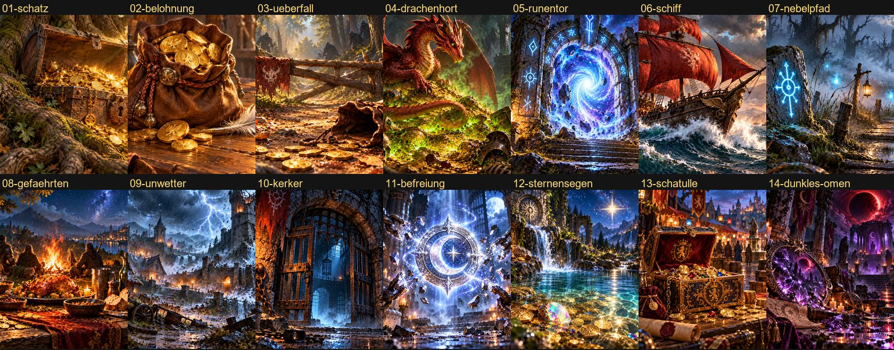 |
| Karte am TV | 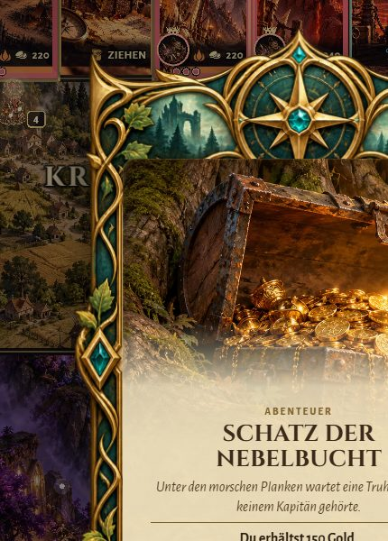 |
| Karte auf dem Handy | 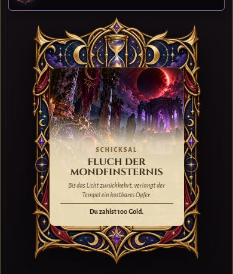 |
| Kartenziehen (bewegt) | 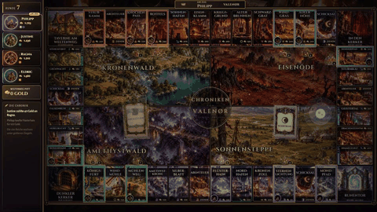 |

## 2. Charakterkarten

- **Aufbau:** Jeder Spieler hat links eine Karte mit großem Porträt im Ring der Spielerfarbe, Name und Gold.
- **Gruppenpunkte:** Darunter steht ein Punkt je Grundstücksgruppe, in der der Spieler Felder besitzt, in der Gruppenfarbe. Ein Ring heißt „Felder der Gruppe“, ein gefüllter Punkt „ganze Gruppe“.
- **Aktive Karte:** Die Karte am Zug rückt leicht vor und bekommt einen Goldrahmen, Licht in Spielerfarbe, langsamen Schimmer und das Schild „AM ZUG“.
- **Gold:** Es zählt sichtbar hoch (grün) oder runter (rot), in etwa 0,9 s. Auf „low“ und bei reduzierter Bewegung springt der Wert ohne Zählen.

| Spielerleiste | Detail |
| --- | --- |
| 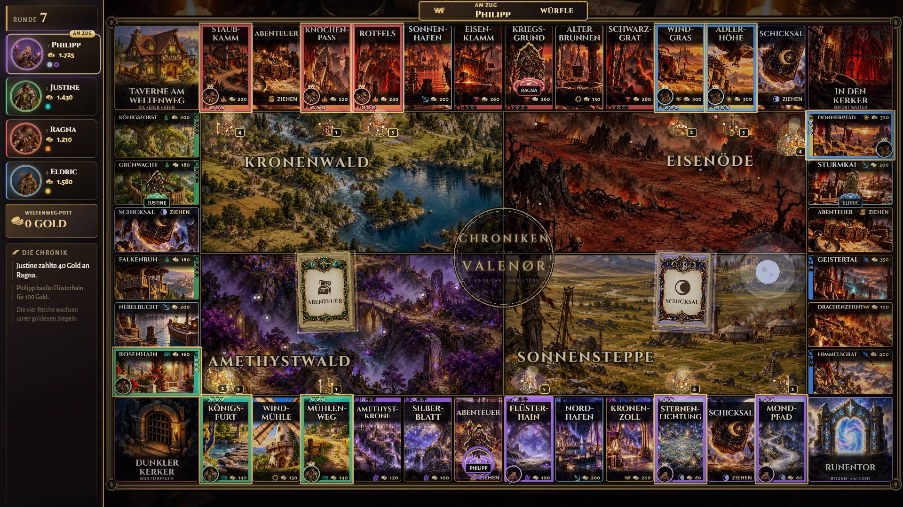 | 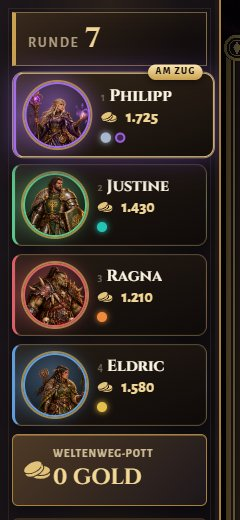 |

## 3. Handy-Hintergrund je Reich

- **Bild:** Hinter dem Handy liegt das Feldbild, auf dem die eigene Figur steht: abgedunkelt, unscharf, mit dunklem Schleier. Beim Weiterziehen blendet das neue Bild weich ein.
- **Lesbarkeit:** Ein Test rechnet nach, dass selbst ein rein weißes Bild hinter dem Text genug Kontrast lässt (Fließtext AAA, gedämpfter Text AA).

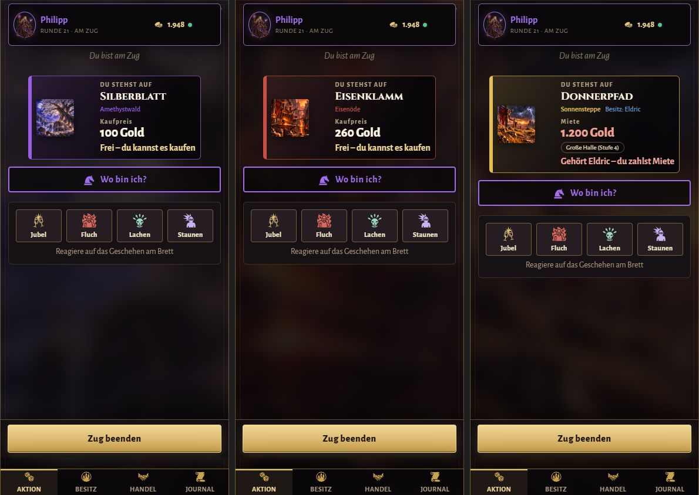

## 4. Siegerehrung mit Statistik

- **Der Moment (etwa 5 s):**
  - Die Kamera fährt auf die Siegerfigur und bleibt dort. Der Sieg ist die einzige Fahrt, die länger als 2 s dauern darf, denn danach handelt niemand mehr.
  - Das Brett dunkelt ab und lässt die Figur im Licht, ein Lichtkegel fällt von oben, und goldene Funken regnen herab.
  - Der Chronist verkündet den Sieg mit der Siegeszeile der Figur.
  - Oben erscheint ein schmales Siegesbanner.
- **Die Ehrung:**
  - **Podest:** Platz 2 links, Platz 1 in der Mitte mit Krone, Platz 3 rechts; die übrigen Plätze stehen darunter.
  - **Auszeichnungen:** Jede geht an genau einen Spieler: Großgrundbesitzer, Baumeister, Pechvogel, Händlerkönig, Stammgast im Kerker, Drachenfreund, Mietkönig, Schnäppchenjäger, Runenwanderer, Schicksalsleser, Glückskind, Treuer Steuerzahler. Wer keine bekommt, erhält „Standhafter Gefährte“ oder „Tapfer gefallen“, so geht niemand leer aus.
  - **Diagramm:** Das Vermögen jedes Spielers je Runde, in den Spielerfarben. Die Linien zeichnen sich nacheinander. Eine Legende ist immer da, bei bis zu 4 Spielern stehen die Namen zusätzlich direkt am Linienende. Beim Überfahren zeigt ein Fadenkreuz die Werte aller Spieler, und für Screenreader gibt es eine Tabelle.
  - **Rekorde:** höchste Miete, teuerster Kauf, längste Zeit im Kerker, größter Reichtum, gespielte Runden.
- **Handy:** Platz, die eigenen Auszeichnungen, der eigene Vermögensverlauf und eigene Zahlen (Miete gezahlt und kassiert, Käufe, Bauwerke, Handel, Züge im Kerker).
- **Wer später dazukommt** (Neuladen), sieht gleich die Ehrung statt den Moment noch einmal.
- **Ruhig:** Auf „low“ und bei reduzierter Bewegung gibt es nur einen ruhigen Lichtring, keine Fahrt und keine Funken, und die Ehrung erscheint ohne Animation.

**Statistik:**

- Der Server sammelt sie nur im Arbeitsspeicher, solange die Partie läuft. Es gibt keine Datenbank und keine Datei.
- Sie entsteht, indem jeder neue Spielstand mit dem vorigen verglichen wird. Keine Spielregel liest sie.
- Eine neue Partie im selben Raum beginnt mit leerer Statistik.
- Das Wirtschaftsprotokoll hält nur die letzten 12 Einträge; neue Einträge werden über ihre ID erkannt, sodass nichts doppelt zählt.
- Das Vermögen ist Gold plus Kaufwert von Grundstücken und Gebäuden, abzüglich offener Hypotheken.

| Ansicht | Bild |
| --- | --- |
| Siegmoment | 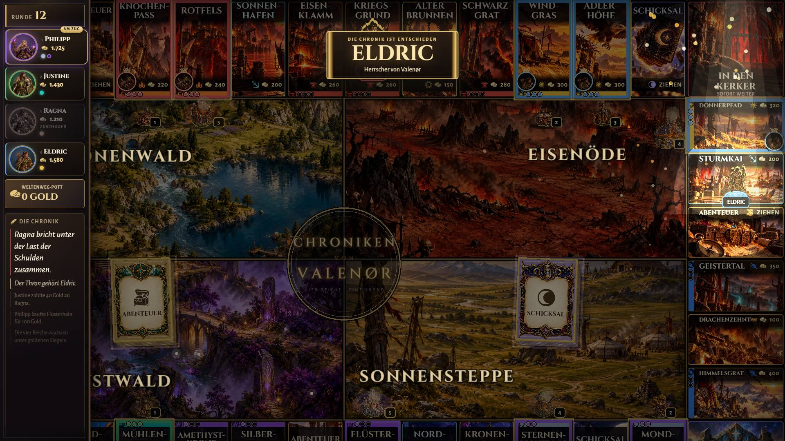 |
| Siegerehrung | 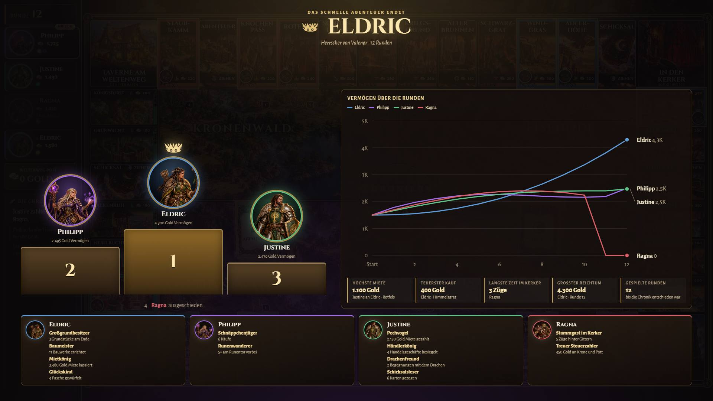 |
| Handy: Sieger und Platz 2 | 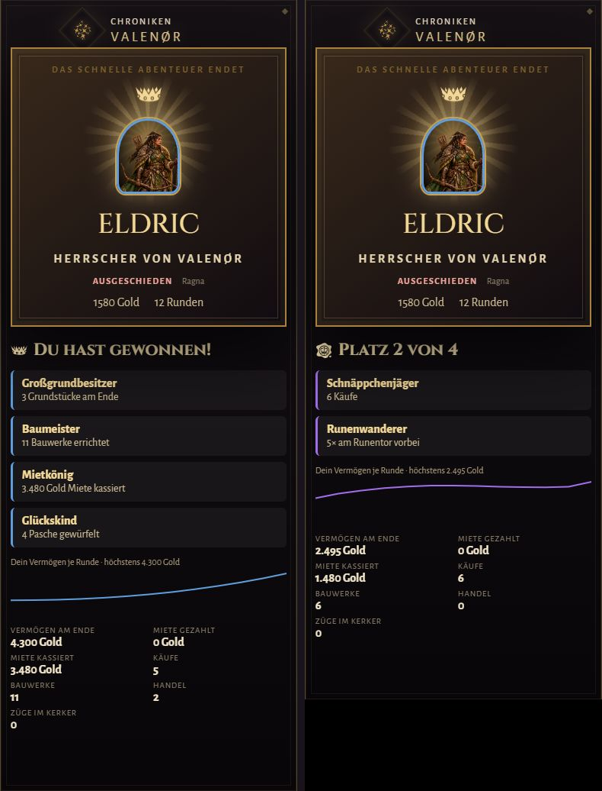 |
| Ablauf (bewegt) | 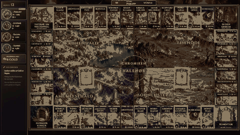 |

## Bildrate

Gemessen am 28.10.2026, allerdings im **Akkubetrieb**:

- **Hardware und Browser:** Intel Iris Xe, Chromium mit D3D11, 1920×1080.
- **Drosselung:** Windows drosselt die Grafik im Akkubetrieb stark. Auf dem Brett liefern dabei *beide* Stände nur 3–13 FPS, auch auf „low“. Eine leere Seite schafft weiter 60 FPS.
- **Vergleichbarkeit:** Die absoluten Werte sind deshalb nicht mit den 50–60 FPS der letzten PRs vergleichbar, die am Netzteil gemessen wurden.

Damit die Aussage trotzdem belastbar ist, habe ich `main` und diesen Branch abwechselnd unter denselben Bedingungen gemessen (je 3 Durchgänge, Median, Bilder pro Sekunde):

| Szene | main high | Branch high | main low | Branch low |
| --- | --- | --- | --- | --- |
| Ruhendes Brett (Nacht) | 6,7 | 6,9 | 11,7 | 10,3 |
| Ziehen mit Kamera | 2,6 | 3,1 | 6,2 | 9,8 |
| Kartenziehen | 2,3 | 3,3 | 4,6 | 3,3 |
| Endbildschirm (main: alte Ergebnistafel, Branch: Siegerehrung) | 5,8 | 7,2 | 7,0 | 6,1 |

- **Ergebnis:** Beide Stände liegen innerhalb des Messrauschens gleichauf. Charakterkarten, Kartenbilder und Siegerehrung kosten also nichts Messbares.
- **Offen:** Eine Messung am Netzteil steht noch aus.

## Visual-QA-Szenen

- **TV:** `card-flip`, `victory` (mit Siegmoment), `victory-ceremony` (gleich die Ehrung); die Charakterkarten sind in jeder Brettszene zu sehen.
- **Handy:** `mobile-action-fate` (Karte), `mobile-realm-elves`, `mobile-realm-orcs`, `mobile-realm-steppe`, `mobile-victory`, `mobile-victory-second`.
