# Design-System „Codex“ – Vorher/Nachher

Ausgewählte Ansichten aus `/visual-qa` vor und nach der Umstellung auf das Design-System „Codex“ (Tokens, Cinzel und Alegreya Sans, Game-Icons). TV-Ansichten wurden in 1920 × 1080 aufgenommen und auf 960 px verkleinert, Handy-Ansichten in 390 px Breite.

| Ansicht | Vorher | Nachher |
| --- | --- | --- |
| Spielbrett (TV) | 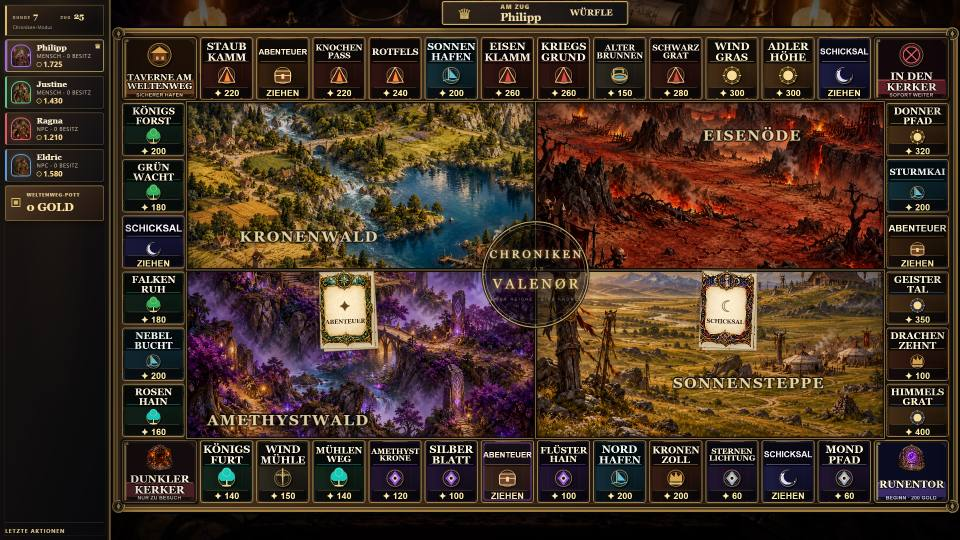 | 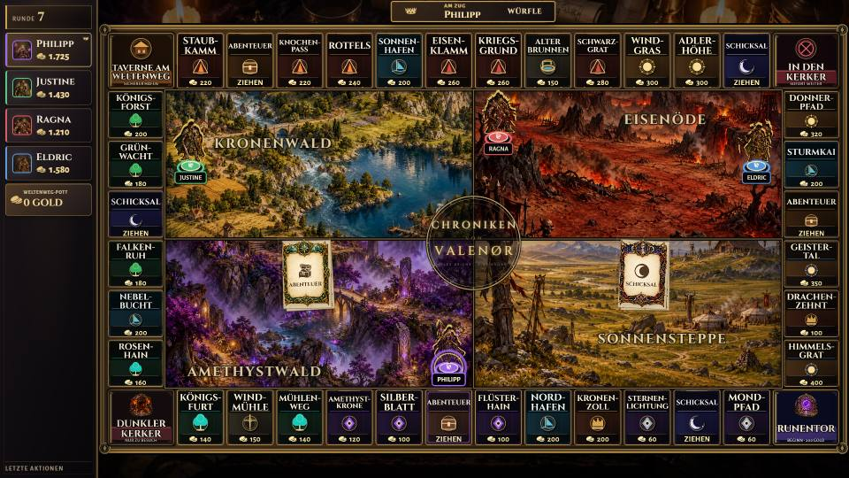 |
| Auktion (TV) | 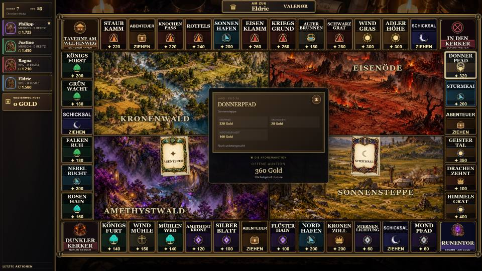 | 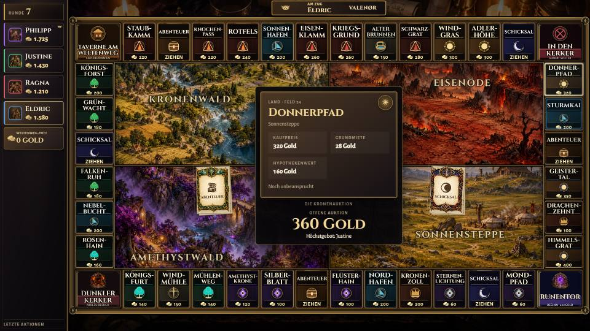 |
| Siegerbildschirm (TV) | 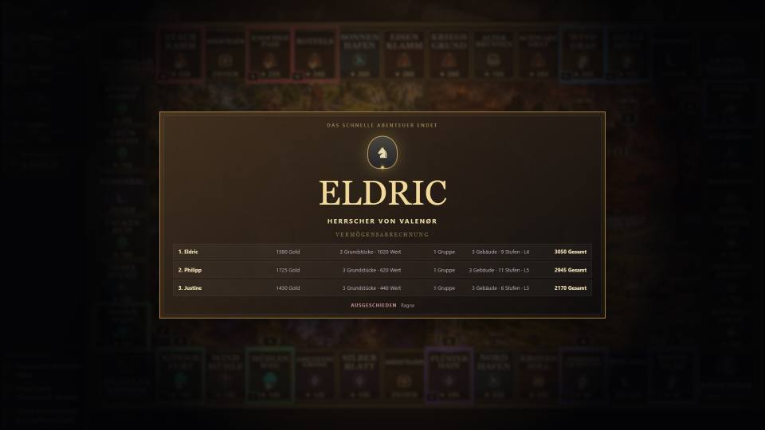 | 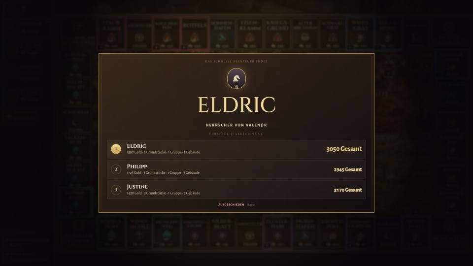 |
| Lobby (TV) | 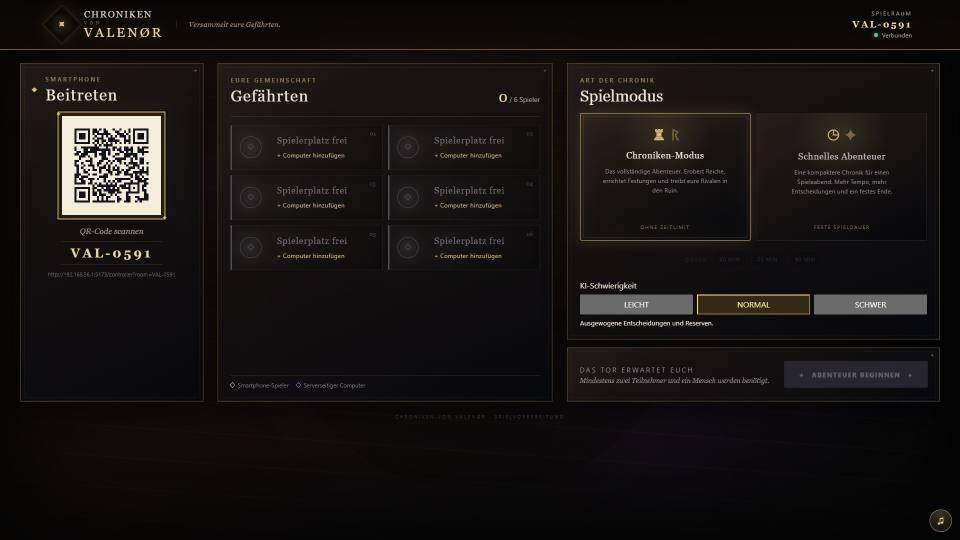 | 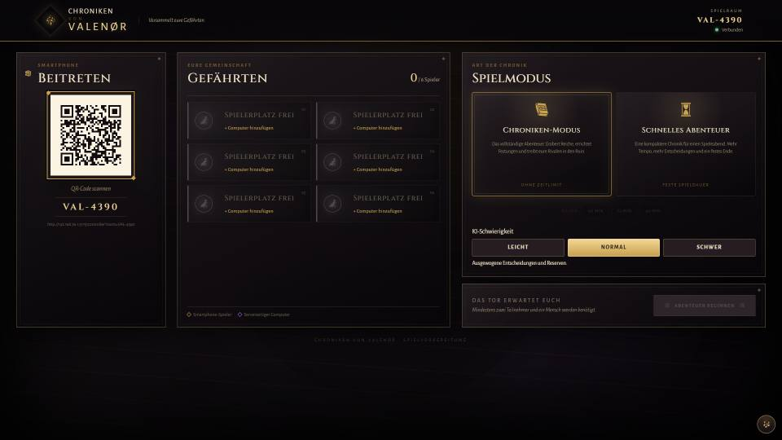 |
| Schnellhandel, Angebot (Handy) | 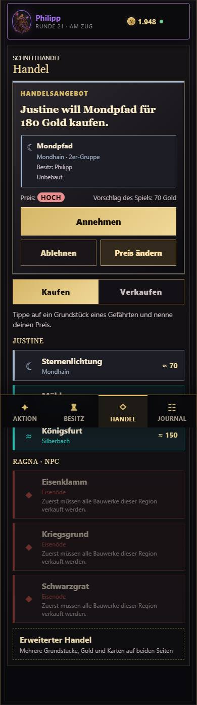 | 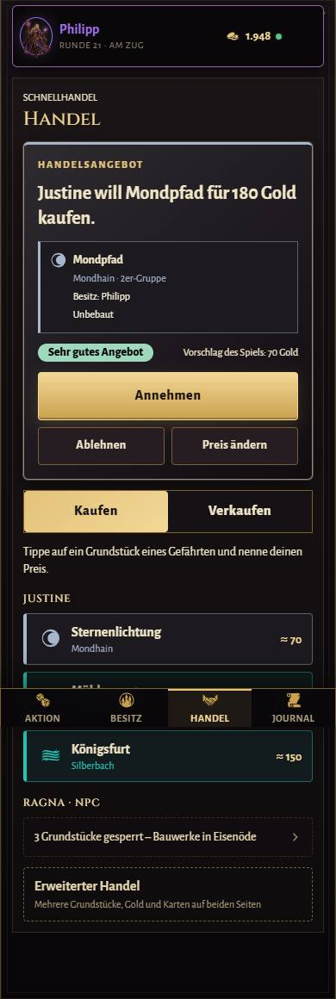 |
| Mein Besitz (Handy) | 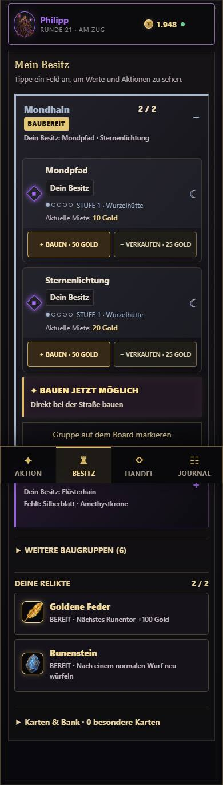 | 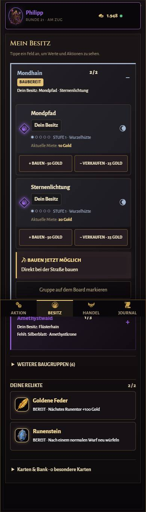 |
| Am Zug (Handy) | 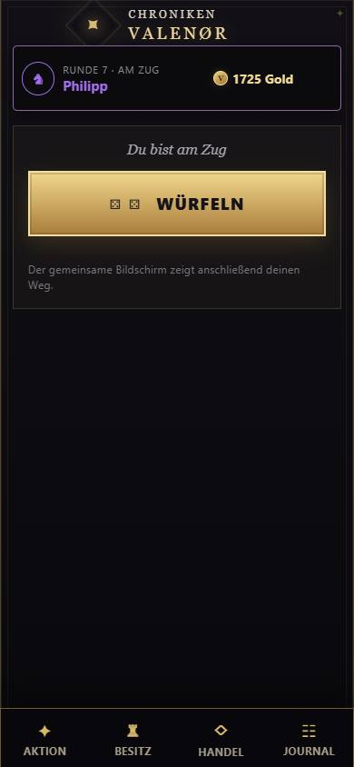 | 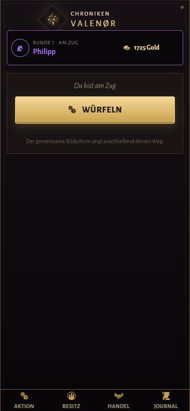 |
| Zahlung (Handy) | 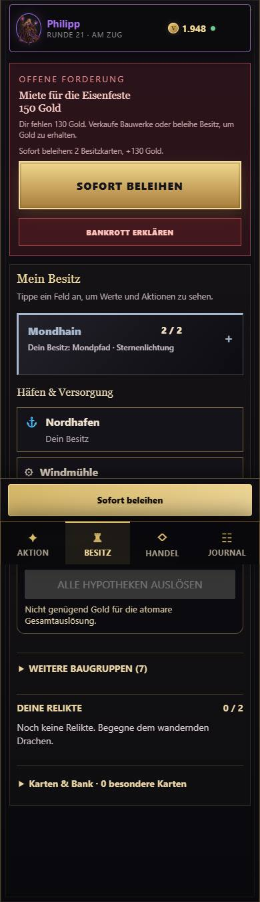 | 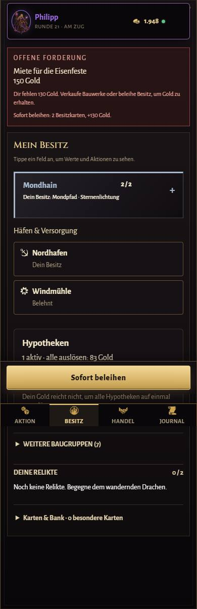 |

## Nachbesserungen

| Ansicht | Bild |
| --- | --- |
| Schnellhandel: Preisbewertung aus Sicht des Betrachters (hier Verkäufer, grün) |  |
| Gesperrte Grundstücke als einklappbare Zeile je Region | 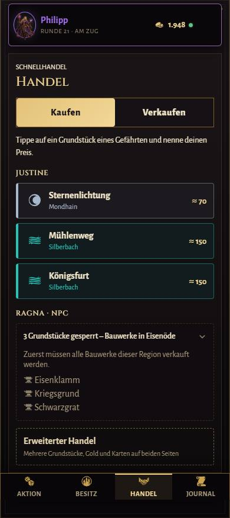 |
| „Mitwirkende“ in der Lobby (Produktions-Build) | 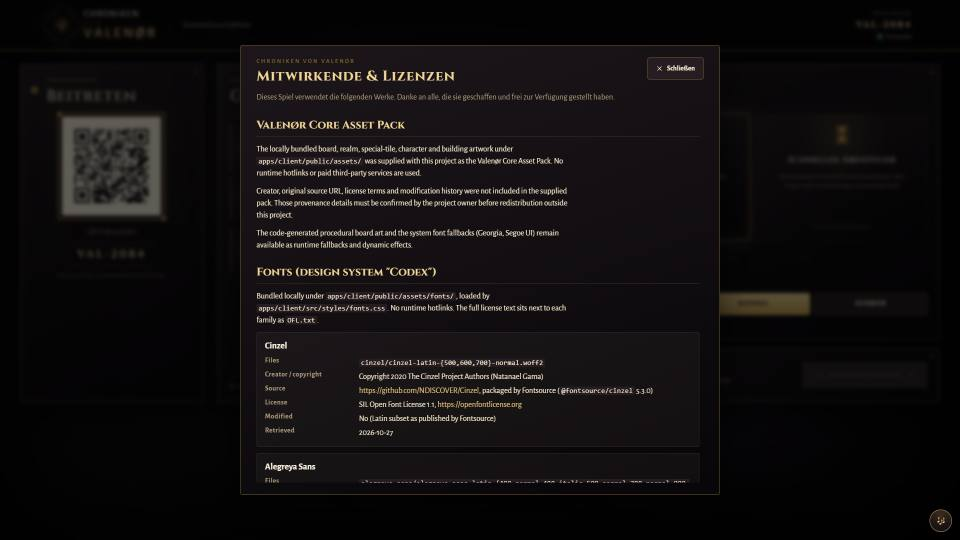 |

Neu erzeugen: Dev-Server starten (`npm run dev`) und die Szenen unter `http://localhost:5173/visual-qa?scene=<name>` in beiden Breiten aufnehmen.
