# Feinschliff

Studio-Optik für Würfel, Meldungen, Kartenstapel und Stimmungen, dazu vier Rückmeldungen vom Spieltisch. Die Spielregeln sind unverändert, es gibt keine Datenbank.

## Teil A – Studio-Optik

### Würfel aus dunklem Stein

Ausgewählt aus zwei Varianten (heller Knochen, dunkler Stein):

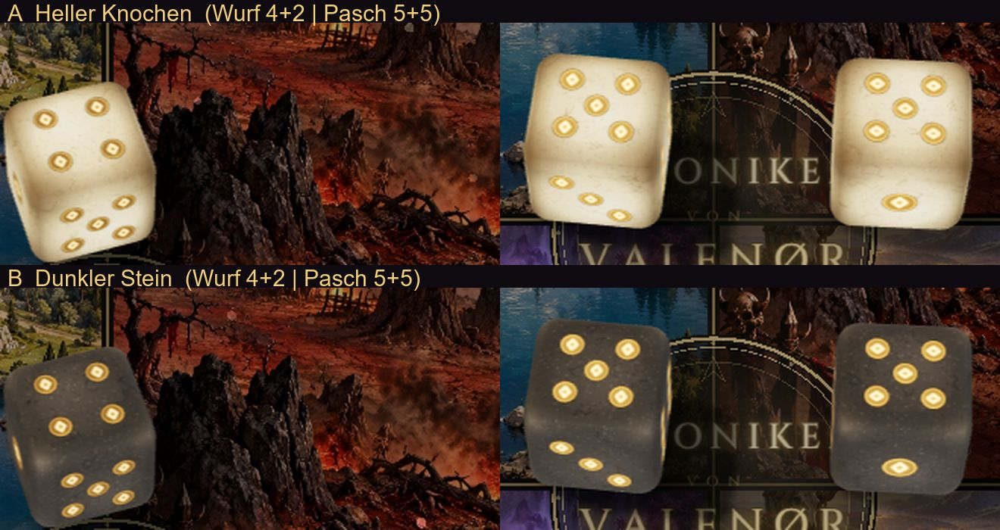

- **Material:** Gekörnter, fast schwarzer Stein mit feinen Rissen, hell abgeschlagenen und kräftig abgerundeten Kanten. Ein Reliefbild gibt der Oberfläche Struktur.
- **Augen:** Eingravierte Mulden, in denen die Rauten-Rune Ingwaz (ᛜ) golden leuchtet.
- **Licht:**
  - Weiches Umgebungslicht für glaubwürdige Reflexe und warmes Licht von hinten links.
  - Ein weicher Kontaktschatten fällt nach vorn rechts, wo die Kamera ihn sieht.
  - Die Würfel wirken etwa ein Sechstel kleiner als vorher.
- **Pasch:** Statt des großen gelben Rings glühen die Runen golden auf, darunter liegt ein dezenter Lichtschein.

| Wurf 4 + 2 und Pasch 5 + 5 | Bewegt |
| --- | --- |
| 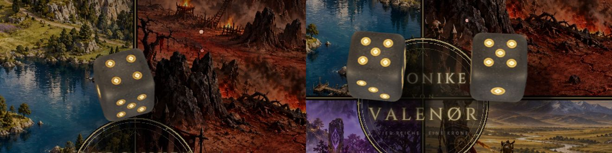 | 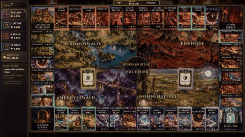 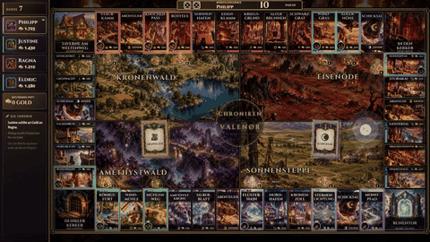 |

### Meldungen als Schriftrolle

- **Gestaltung:** Landung, Drache und Relikt, Chronik-Ereignisse, Taverne, Bau, Kerker und Weltimpulse erscheinen als breites Banner mit goldenen Rollstäben, doppeltem Goldrahmen und Ornamenten. Es entrollt sich von der Mitte aus.
- **Lage:** Das Banner sitzt wie ein Film-Untertitel im unteren Drittel.
- **Nie über dem Geschehen:** Liegt das Landefeld oder das Ziel einer Kamerafahrt unten im Bild, rückt das Banner nach oben unter die Anzeige „Am Zug“. Das Brett meldet dafür `data-focus-zone` am Canvas, ein Test sichert die Regel ab.
- **Vorrang:** Erscheint eine Ereignismeldung, tritt die Landekarte zurück, damit sich nichts überlagert.

| Ansicht | Bild |
| --- | --- |
| Landung unten (Silberblatt): Banner oben | 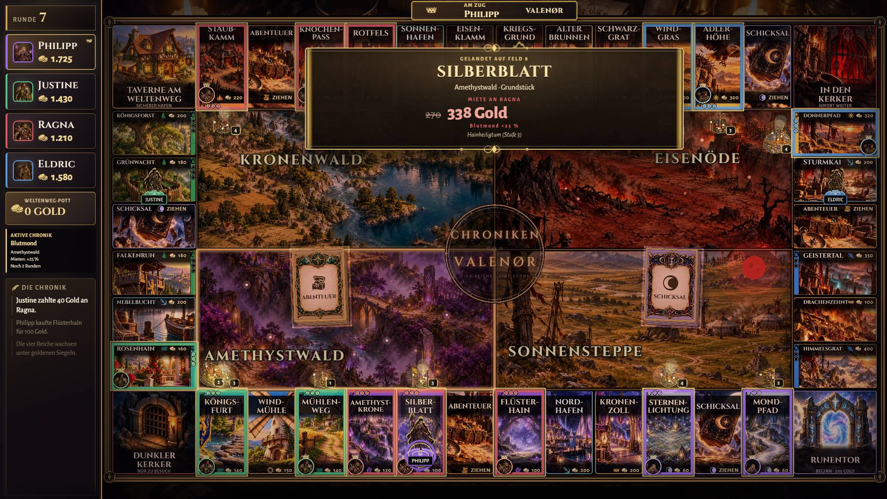 |
| Kamerafahrt zur oberen Reihe: Banner unten | 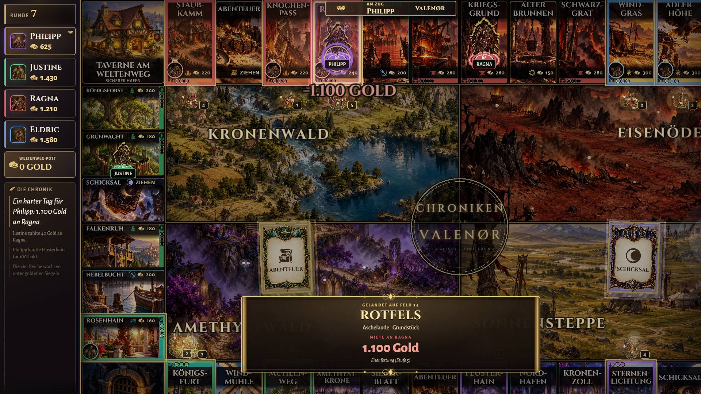 |
| Chronik-Ereignis | 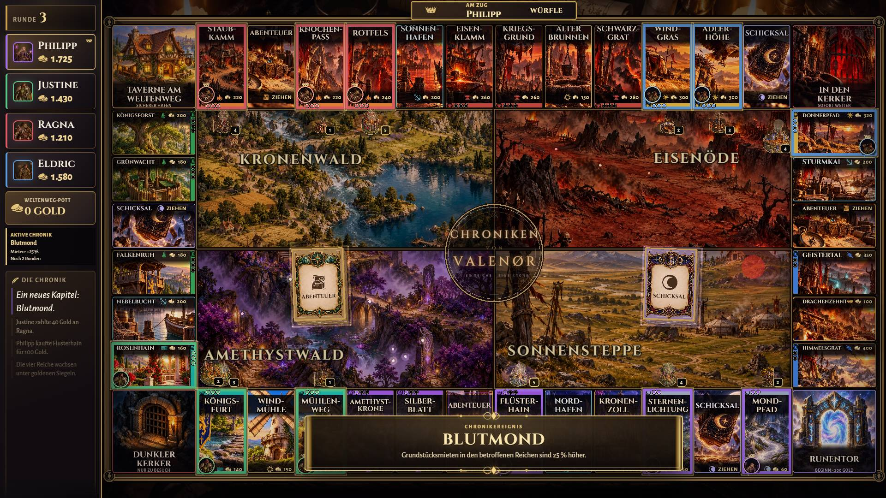 |
| Stufe 5 mit Kamerafahrt | 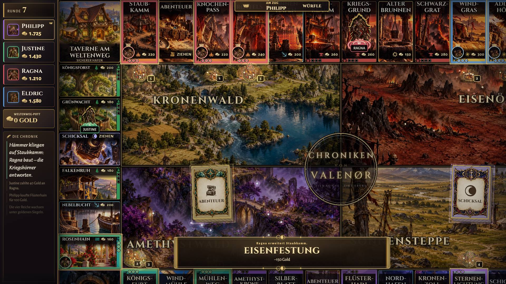 |
| Drache und Relikt | 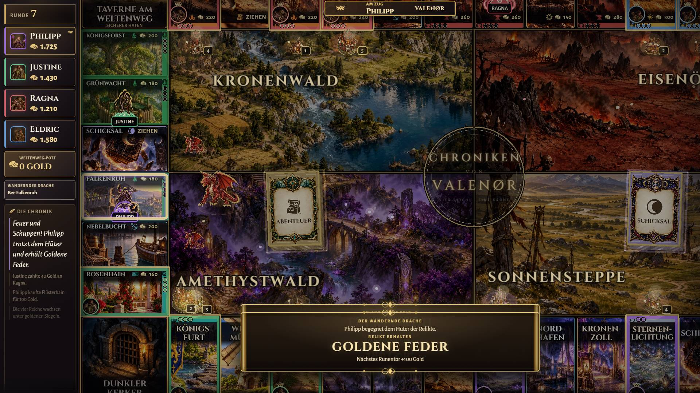 |
| Bewegt | 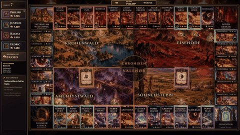 |

### Kartenstapel

- **Dicke:** Neun sichtbare Kartenkanten, abwechselnd heller und dunkler.
- **Rahmen und Licht:**
  - Ein weicher, mehrstufiger Schatten unter dem Stapel.
  - Ein goldener Rahmen mit feiner Innenlinie.
  - Ein ruhig atmendes Glühen, und ab und zu gleitet ein Lichtstreif über die oberste Karte.
- **Ziehen:** Die oberste Karte hebt sich in 0,28 s sichtbar ab, darunter liegt die nächste Karte. Erst dann fliegt die große Karte zur Mitte und dreht sich um.
- **Ruhig:** Auf „low“ und bei reduzierter Bewegung gibt es kein Schimmern und kein Abheben.

| Stapel | Abheben, Bild für Bild | Bewegt |
| --- | --- | --- |
| 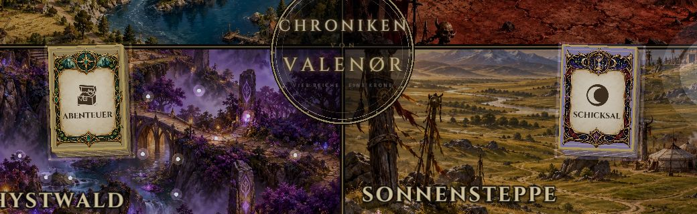 | 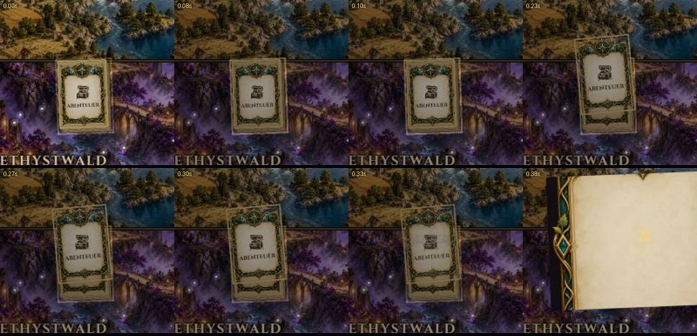 |  |

### Kräftigere Stimmungen

- **Kräftiger:** Die acht Chronik-Stimmungen sind etwa doppelt so deutlich: Schleier, Farbsättigung und Vignette. Dazu gibt es mehr Funken, und die Gebäude glühen stärker.
- **Lesbarkeit:** Über dem Feldring wirkt der Schleier nur halb so stark und damit so stark wie bisher. Namen und Preise bleiben lesbar, ein Test prüft das.

| Stimmungen 1–4 | Stimmungen 5–8 |
| --- | --- |
| 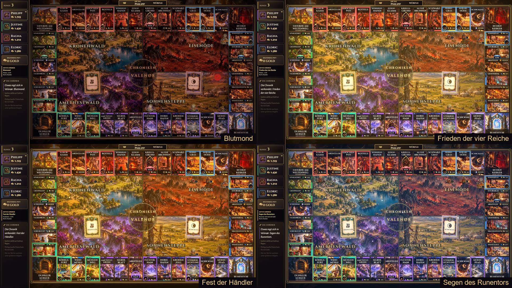 | 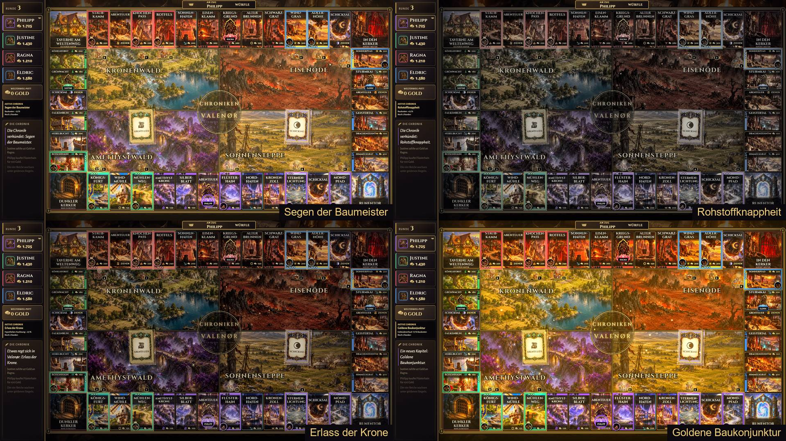 |

## Teil B – Rückmeldungen vom Spieltisch

### 5. Ereignisse auf jedem Handy

- **Hinweis oben:** Solange ein Chronik-Ereignis oder ein noch nicht verbrauchter Weltimpuls wirkt, steht oben auf jedem Handy ein kleiner Hinweis.
- **Antippen:** Zeigt Name, Beschreibung, Wirkung, betroffene Reiche und Dauer, etwa „noch 2 Runden“, „endet mit dieser Runde“ oder „bis zum nächsten Bau“.

### 6. Zielfeld bei jedem Wurf

**Geprüft:** Bisher erschien das Zielfeld nur während des Ziehens und 0,35 s danach, bei 4 Feldern also gut eine Sekunde lang. Das gilt für jeden Wurf, auch beim Pasch und beim Kerkerwurf. Während des Würfelns (1,25 s) fehlte es, und beim dritten Pasch oder einer Kerkerkarte erschien es nie.

**Jetzt:**

- Das Zielfeld steht fest, sobald der Server gewürfelt hat. Ausnahme: Solange der Runenstein über den Wurf entscheidet, wird nichts angezeigt.
- Es bleibt bis zum Zugende oder zum nächsten Wurf sichtbar, nach der Landung etwas kleiner.
- Es gilt für den normalen Wurf, den Neuwurf nach einem Pasch, den Kerker-Pasch, die Bewegung nach der Kerkergebühr, Kartenbewegungen sowie den dritten Pasch und die Kerkerkarte („Ab in den Dunklen Kerker“).

### 7. Miete statt Kaufpreis

TV und Handy zeigen beim Landen:

- **Fremdes Feld:** groß die Miete, die man zahlt, mit Besitzer und Aufschlüsselung, zum Beispiel „Hainheiligtum (Stufe 3)“, „Gruppe komplett – doppelte Miete“, „3 Häfen“ oder „Wurf 7 × 10“. Ereignisse wie „Blutmond +25 %“ sind eingerechnet.
- **Freies Feld:** der Kaufpreis.
- **Eigenes Feld:** „Dein Grundstück“ (am TV „Eigenes Grundstück von …“).

### 8. Baukosten bei Ereignissen

**Geprüft:** Das war kein Rechenfehler.

- Handy, TV und Server rechnen mit denselben Funktionen, der Server bucht genau diesen Preis ab.
- Die Ereignisse gelten aber nur für die genannten Reiche und Feldarten, zum Beispiel „Segen der Baumeister“ nur in Kronenwald und Eisenöde.
- Das Handy zeigte nie an, ob ein Preis verändert ist. Deshalb sah es so aus, als ändere sich nichts.

**Jetzt:**

- Überall, wo ein Ereignis, ein Weltimpuls oder ein Relikt einen Preis verändert, steht der alte Preis durchgestrichen, der neue daneben und darunter der Grund. Das gilt für Bauen, Kauf, Miete, Hypothek-Auslösung und Gebäudeverkauf.
- Neue Funktion `getPriceInfo` in `@valenor/shared`. Sie erklärt nur den Preis, berechnet wird er weiter von den bisherigen Funktionen.

| Zielfeld: Miete mit Blutmond, Kauf mit Fest, Kerker | Ereignisse, Baupreise in Übersicht und Detail |
| --- | --- |
| 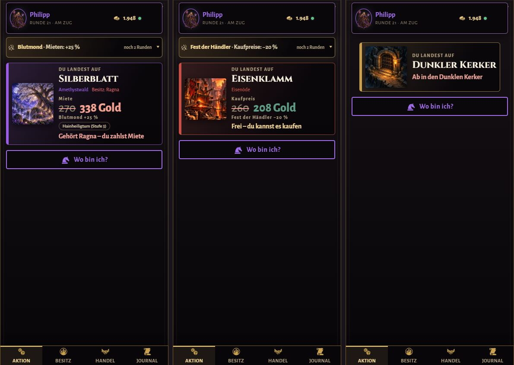 | 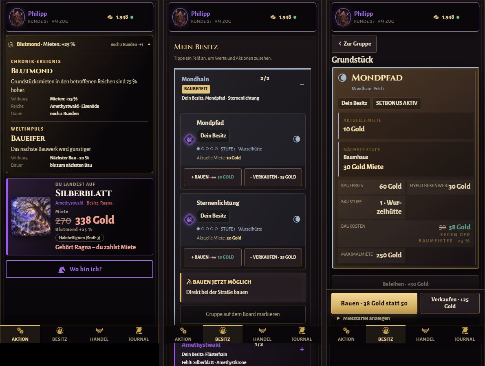 |

| TV: Kaufpreis mit Ereignis | TV: eigenes Grundstück |
| --- | --- |
| 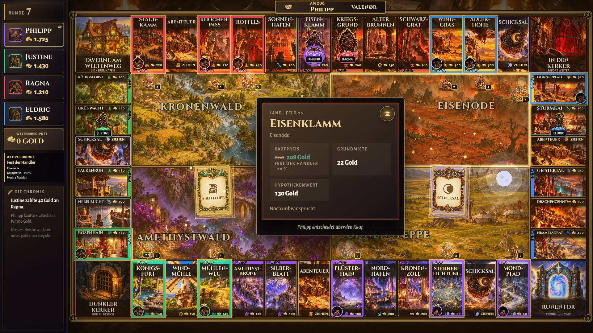 | 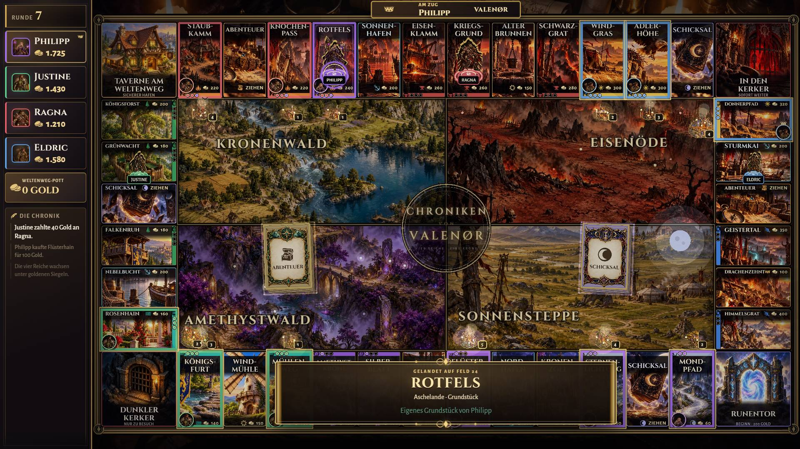 |

## Bildrate

Gemessen am 28.10.2026:

- **Hardware und Browser:** Intel Iris Xe, Chromium mit D3D11, 1920×1080.
- **Messung:** Takt von `requestAnimationFrame`.
- **Werte:** Median aus drei Läufen, in Klammern die Spanne.

| Szene | high | medium | low |
| --- | --- | --- | --- |
| Ruhendes Brett (Nacht) | 58 (46–58) | 59 (56–60) | 60 (54–60) |
| Mietmoment mit Kamerafahrt und Banner | 53 (52–54) | 54 (53–54) | 56 (42–56) |
| Würfelwurf (auf low klassisch) | 47–50 (45–54) | 51–52 (42–54) | 57–58 (56–60) |
| Ziehen mit Mitgehen | 56 (55–56) | 51 (47–57) | 60 (49–60) |
| Fest der Händler mit Funken | 56 (50–57) | 59 (56–60) | 59 (56–60) |

- **Messrauschen:** Auf diesem Laptop schwanken einzelne Läufe stark, weil nebenher andere Programme laufen. Deshalb gilt der Median.
- **Vergleich:** Die Werte liegen auf dem Niveau des letzten PRs. Der Steinwürfel kostet auf „high“ etwas mehr (Relief, Leuchtbild, Umgebungslicht).
- **Banner:** Das Entrollen animiert nur `transform` und `opacity`, damit der Browser das Banner nicht in jedem Bild neu zeichnet.

## Visual-QA-Szenen

- **TV (1920×1080):**
  - `landing-free-discount`, `landing-rent-low`, `landing-own`
  - außerdem `dice-roll`, `dice-double`, `card-flip`, `camera-*` und `mood-*`
- **Handy (390 px):** `mobile-target-rent-event`, `mobile-target-buy-event`, `mobile-target-dungeon`, `mobile-world-status`, `mobile-prices-event`, `mobile-prices-event-detail`

## Tests

- **Preise:** Für alle 8 Ereignisse, jedes Reich, alle Felder und alle Preisarten gilt, dass der angezeigte Preis gleich dem abgerechneten ist und jede Änderung einen Grund nennt. Außerdem: Ereignisse wirken nur in ihren Reichen, Weltimpulse und Relikte werden genannt, die Miete wird aufgeschlüsselt.
- **Zielfeld:** Würfeln, Pasch, Runenstein, Kerker, Kartenbewegung, dritter Pasch, Sichtbarkeit bis Zugende, Miete groß, „Dein Grundstück“.
- **Ereignisse am Handy:** Name, Wirkung, Reiche, Dauer, verbrauchte Weltimpulse verschwinden.
- **Banner:** Lage nach Fokus, auch während einer Kamerafahrt.
- **Stimmungen:** Mindestens 20 % Schleier im Inneren, über den Feldern höchstens 18 %.
