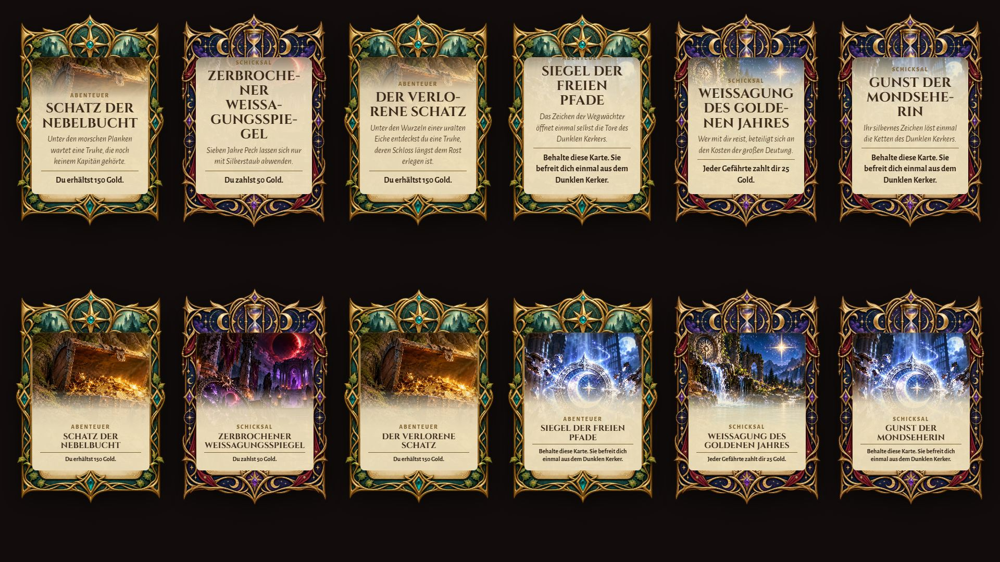
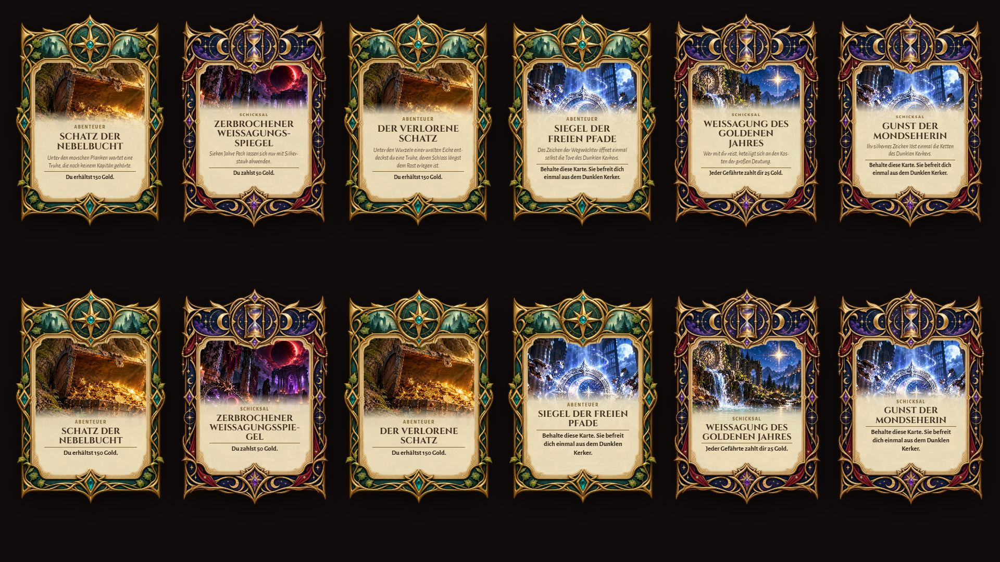
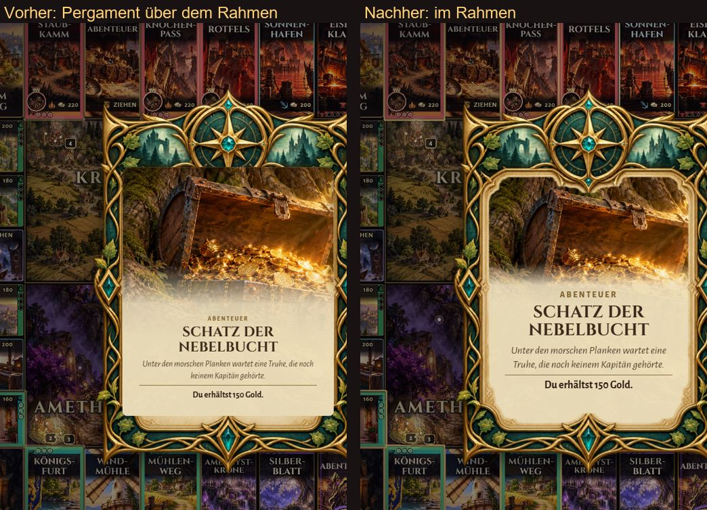
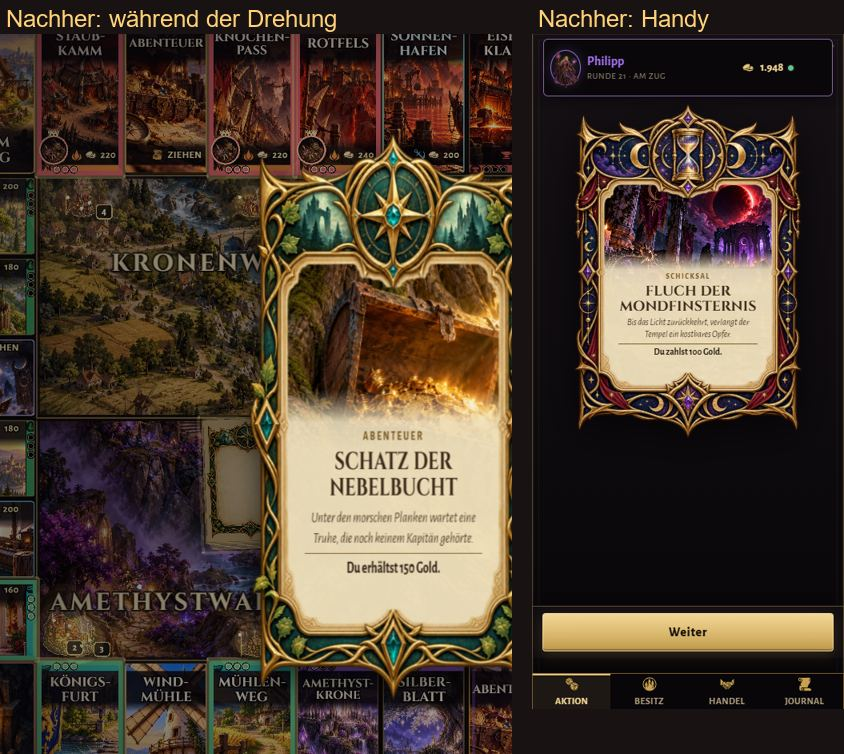
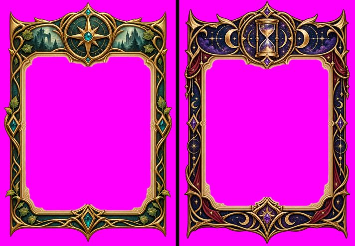
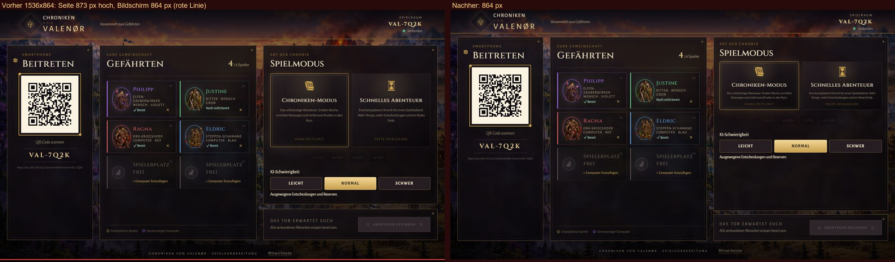
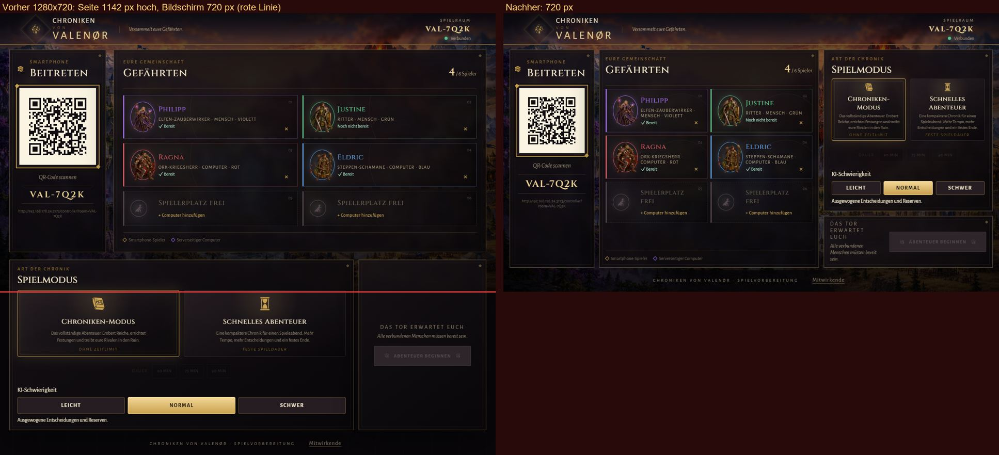

# Fix: Kartenrahmen und Scrollbar im Vollbild

## 1. Kartenrahmen

**Fehler:** Bild und Pergament lagen als Rechteck *über* dem verzierten Rahmen. Oben verdeckten sie die Medaillons, seitlich schnitten die Kanten über die goldenen Ranken.

**Jetzt:** Die Karte besteht aus drei Ebenen.

1. **Hinten** liegt der vollständige Rahmen. Er gibt die Größe vor.
2. **In der Mitte** liegen Bild und Pergament mit Titel und Text, zugeschnitten auf genau die innere Öffnung des Rahmens (CSS-Maske).
3. **Vorn** liegt der Rahmen noch einmal als Deckschicht mit ausgeschnittener Öffnung. Nichts ragt über Medaillons oder Ranken.

**Wie die Öffnung ermittelt wird:**

- `scripts/card-frame-openings.py` misst die Öffnung aus den Rahmenbildern selbst, statt sie zu schätzen.
- Das Pergament innen ist im Bild gemalt und nicht transparent. Deshalb unterscheidet das Werkzeug nach Farbe: Pergament ist hell und blass, Gold und Ornamente sind gesättigt oder dunkel.
- Von der Mitte aus füllt es die zusammenhängende Pergamentfläche und schließt Flecken darin.
- Dünne Ausreißer in blasse Goldstellen entfernt es, kleine Einbuchtungen glättet es.
- Zur goldenen Innenlinie hält die Öffnung 6 px Abstand.

**Was das Werkzeug erzeugt:**

- die Deckschichten `CardAbenteuer-overlay.webp` und `CardSchicksal-overlay.webp`,
- die Masken `…-opening.png`,
- `apps/client/src/game/assets/card-frame-openings.ts` mit Lage der Öffnung und sicherer Textfläche. Unten ragen Medaillon und Ecken in die Öffnung, dort hält der Text Abstand.

**Gilt überall:** Abenteuer- und Schicksalskarten, TV und Handy, auch während der Dreh-Animation. Die Deckschicht dreht mit, weil sie Teil der Karte ist.

**Größen:** Innerhalb der Öffnung rechnen alle Größen in Anteilen der Öffnung (Container-Einheiten). So ist die Karte auf TV und Handy gleich aufgebaut.

| | Bild |
| --- | --- |
| Vorher: 6 Karten groß und kompakt |  |
| Nachher, darunter langer Titel (Zerbrochener Weissagungsspiegel), langer Text (Der verlorene Schatz) und lange Wirkung (Siegel der freien Pfade) |  |
| TV vorher / nachher |  |
| Während der Drehung und auf dem Handy |  |
| Deckschichten: Rahmen mit ausgeschnittener Öffnung (magenta = Öffnung) |  |

Neue Visual-QA-Szene: `card-gallery` (6 Karten groß und kompakt).

## 2. Scrollbar im Vollbild

**Ursache:** Die **Lobby** wuchs mit ihrem Inhalt, statt sich nach der Bildschirmhöhe zu richten.

- Bei Windows-Anzeigeskalierung rechnet der Browser auf einem Full-HD-Fernseher mit weniger Pixeln: 125 % ergeben 1536 × 864, 150 % ergeben 1280 × 720.
- Bei 864 px Höhe war die Lobby 873 px hoch. 9 px zu viel reichen für eine Scrollbar.
- Bei 1280 px Breite rutschte die dritte Spalte unter die anderen, und die Lobby wurde 1.142 px hoch.
- Die bisherige Anpassung für flache Bildschirme griff erst ab 820 px Höhe abwärts.
- Spiel, Kartenanzeige und Siegerehrung waren nicht betroffen.

**Behoben (nicht versteckt):**

- **Feste Höhe:** Auf dem TV ist die Lobby genau bildschirmhoch. Kopfzeile, Spalten und Fußzeile teilen sich die Höhe.
- **Flache Bildschirme:** Die Anpassung greift jetzt bis 900 px Höhe. Modus-Karten, Spielerplätze und QR-Code richten sich nach der Bildschirmhöhe; der QR-Code bleibt mindestens 118 px groß und damit gut scanbar.
- **Sehr flache Bildschirme (bis 760 px):** Modus- und Start-Tafel werden kompakter, Texte etwas kleiner. Alle Inhalte bleiben sichtbar.
- **Schmale Querformate:** Ein querliegender TV behält auch bei 1280 px Breite drei Spalten, die Gefährten bekommen dabei die meiste Breite.
- **Raumcode:** Er bleibt in einer Zeile, und der QR-Code wird nie breiter als seine Spalte.
- **Tablets und Handys:** Auf schmalen Hochkant-Bildschirmen darf die Lobby weiter scrollen, das ist nicht der TV.

**Geprüft:**

- **Scrollbar:** 8 Größen × 5 Ansichten ohne Scrollbar. Größen: 1920 × 1080, 1366 × 768, 2560 × 1440, 1536 × 864, 1280 × 720, 1600 × 900, 1440 × 900, 1680 × 1050. Ansichten: Lobby mit Spielern, leere Lobby, Spiel, Kartenanzeige, Siegerehrung.
- **Tafeln:** In beiden Lobbys ragt bei allen 8 Größen kein Inhalt aus seiner Tafel oder in die Fußzeile, weder nach unten noch zur Seite.

| Größe | Vorher / nachher |
| --- | --- |
| 1536 × 864 (Full HD, 125 %) |  |
| 1280 × 720 (Full HD, 150 %) |  |
