# Inszenierung

Große Momente bekommen Kamera, Licht, Bewegung, Klang und Timing wie in einem Studiospiel. Alles ist reine Darstellung: Die Spielregeln, der Spielstand und die Zeiten des Servers sind unverändert. Es gibt keine Datenbank. three.js und cannon-es kommen über npm und werden mit dem Spiel ausgeliefert, nichts wird aus dem Internet geladen.

## Kamera

- **Kurze Fahrten** auf Drache, hohe Miete, komplette Gruppe, Gebäude der Stufe 5, Bankrott, Auktionsbeginn und Sieg: 0,5 s hin, kurz halten, 0,6 s zurück, höchstens 2 s und höchstens 1,35-fach gezoomt.
- **Nicht zu oft:** Jede Art von Fahrt (hohe Miete, Auktion, Gruppe) hat etwa 30 Sekunden Abklingzeit. Drache, Stufe 5, Bankrott und Sieg dürfen immer. Ein wichtigerer Moment übernimmt eine laufende Fahrt, ein unwichtigerer wartet.
- **Sofort zurück:** Handelt jemand (neue Spielphase oder neuer Zug), kehrt die Kamera in 0,25 s zur Gesamtansicht zurück.
- **Im Brett bleiben:** Die Kamera rückt nur so weit zum Ziel, dass nie leerer Tisch ins Bild kommt. Liegt das Ziel am Rand, steht es etwas außerhalb der Bildmitte.
- **Mitgehen beim Ziehen:** Die Kamera folgt der Figur am Zug sanft (ein Viertel des Weges, 1,08-fach) und kehrt beim Landen zurück.
- **Während einer Fahrt** fällt der Schatten der Drama-Effekte halb so stark aus, weil schon der Zoom den Blick lenkt.
- **Schalter am Fernseher:** In den Einstellungen gibt es „Kamerafahrten an/aus“. Die Wahl bleibt auf dem Gerät gespeichert.

| Moment | Bild |
| --- | --- |
| Hohe Miete (Rotfels) | 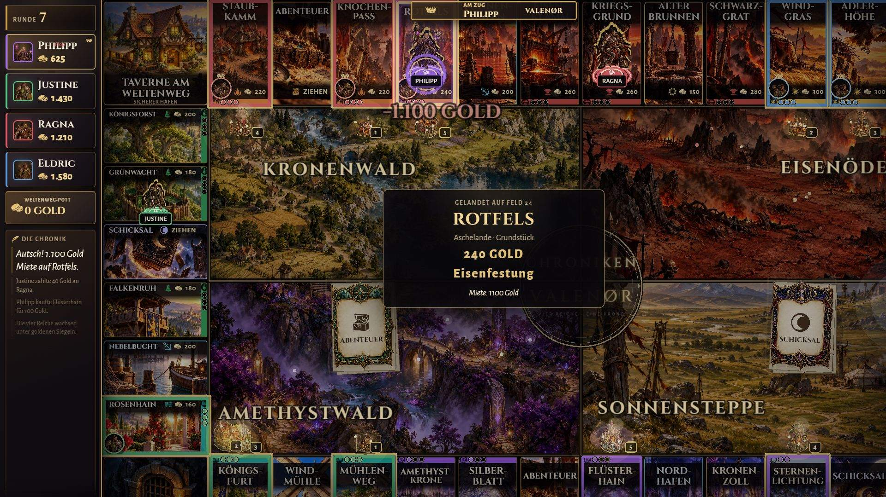 |
| Drache | 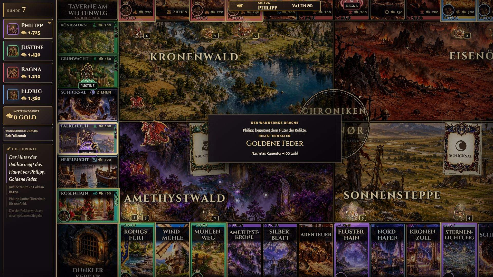 |
| Gruppe komplett (Sonnensteppe) | 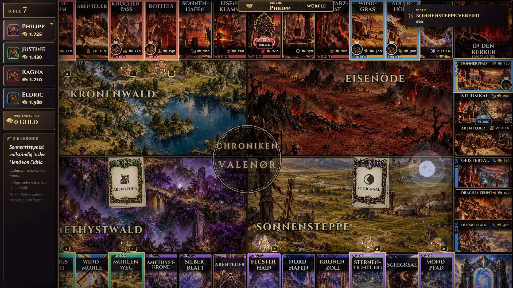 |
| Gebäude Stufe 5 | 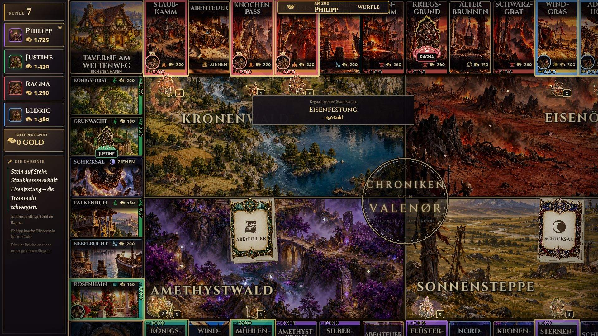 |
| Bankrott | 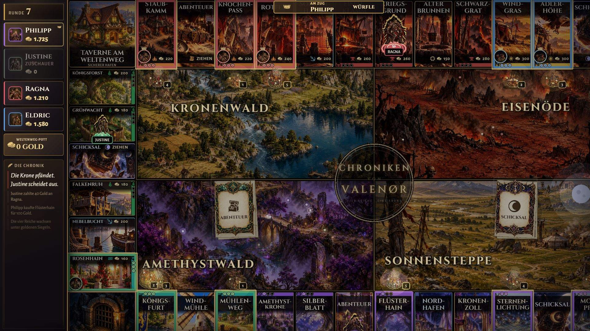 |
| Auktionsbeginn | 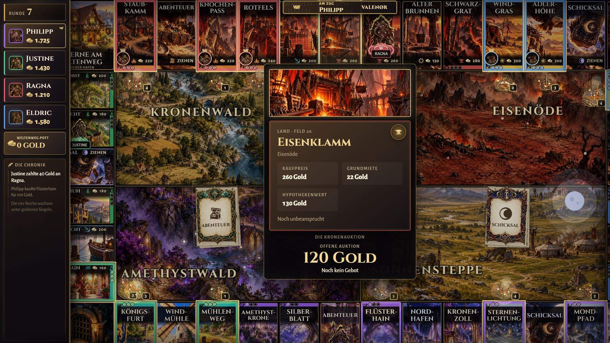 |
| Mitgehen beim Ziehen | 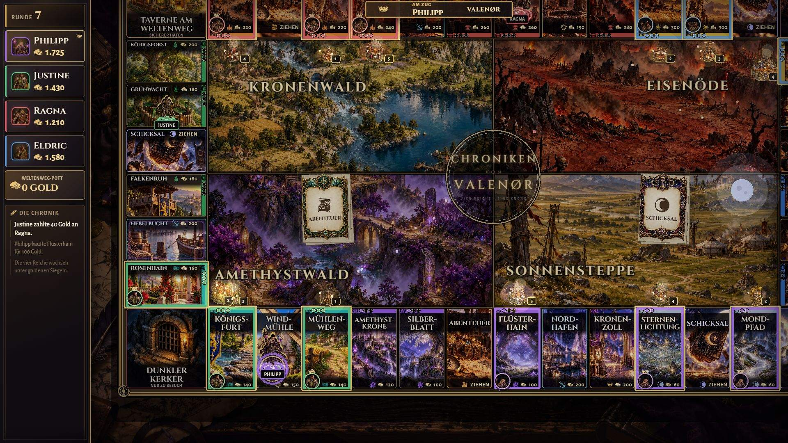 |
| Schalter in den TV-Einstellungen | 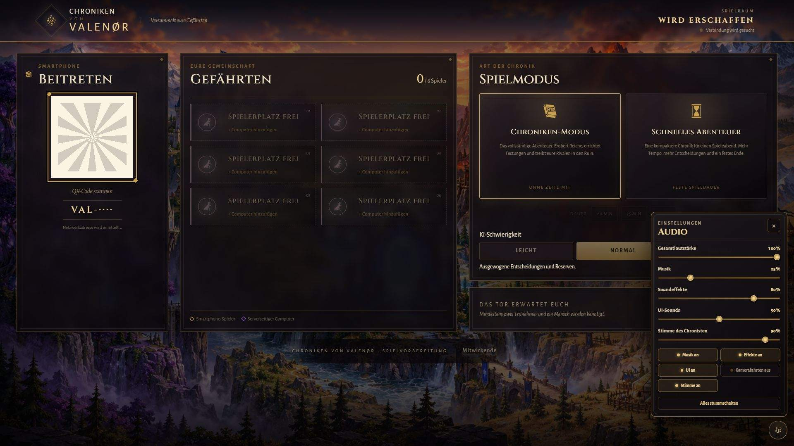 |

Bewegt: 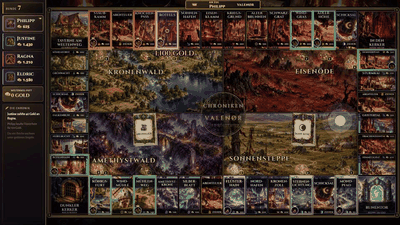 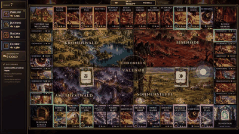

## Großer Spielstart

Einmal pro Partie fliegt die Kamera nacheinander über die vier Reiche und kehrt dann aufs ganze Brett zurück (etwa 6 s). Gleichzeitig spricht der Chronist den Startsatz. Die Tafel „Die Reihenfolge wird bestimmt“ blendet für den Flug aus.

- Der Flug beginnt erst nach dem Intro und läuft parallel zum Auswürfeln der Reihenfolge. Würfelt ein Mensch, bricht er sofort ab.
- Auf dem Handy des Startspielers erscheint „Spielstart überspringen“. Der Server prüft den Tipp: Er gilt nur für den Startspieler, nur in Runde 1 und nur in den ersten 20 Sekunden.
- Nach einem Neuladen startet der Flug nicht noch einmal.

| Ansicht | Bild |
| --- | --- |
| Erstes Reich | 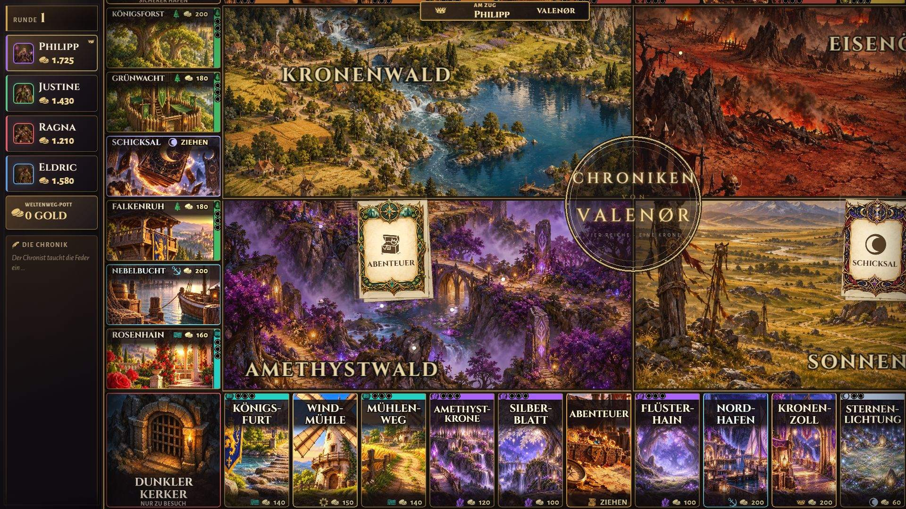 |
| Drittes Reich | 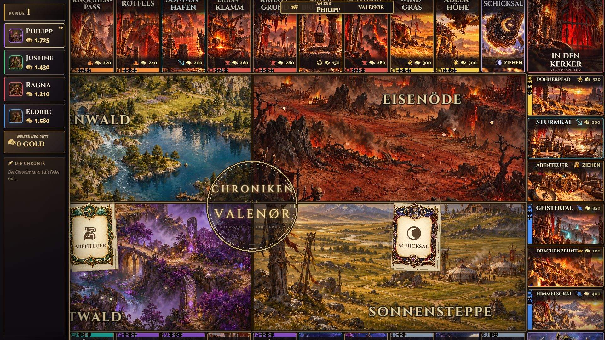 |
| Handy des Startspielers | 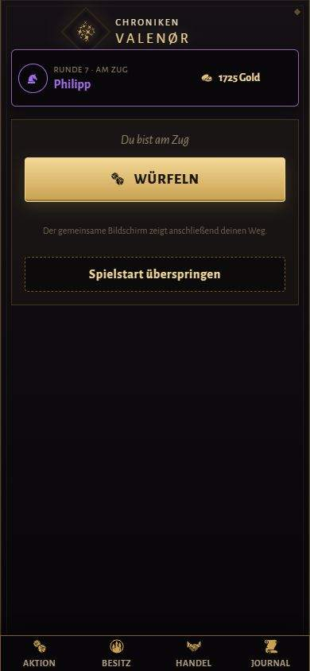 |

Bewegt: 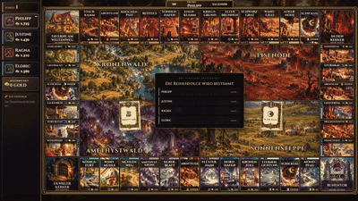

## 3D-Würfel

- Zwei echte 3D-Würfel aus Stein mit goldenen Augen rollen über die Brettmitte, mit Schatten und Aufprall-Klängen.
- **Das Ergebnis kommt nur vom Server.** Der Wurf wird vorab mit cannon-es simuliert. Danach wird das Würfelbild so gedreht, dass die oben liegende Seite genau die Augenzahl des Servers zeigt. Ein Test prüft alle 36 Kombinationen.
- Die Würfel liegen nach 1,1 s still. Der Server wechselt nach 1,25 s ins Ziehen, der Zug dauert also nicht länger.
- **Pasch:** Beide Würfel schimmern golden, dazu breitet sich ein Lichtring aus.
- Auf „low“ und bei reduzierter Bewegung erscheinen die bisherigen Würfel.

| Wurf | Bild |
| --- | --- |
| 4 und 2 | 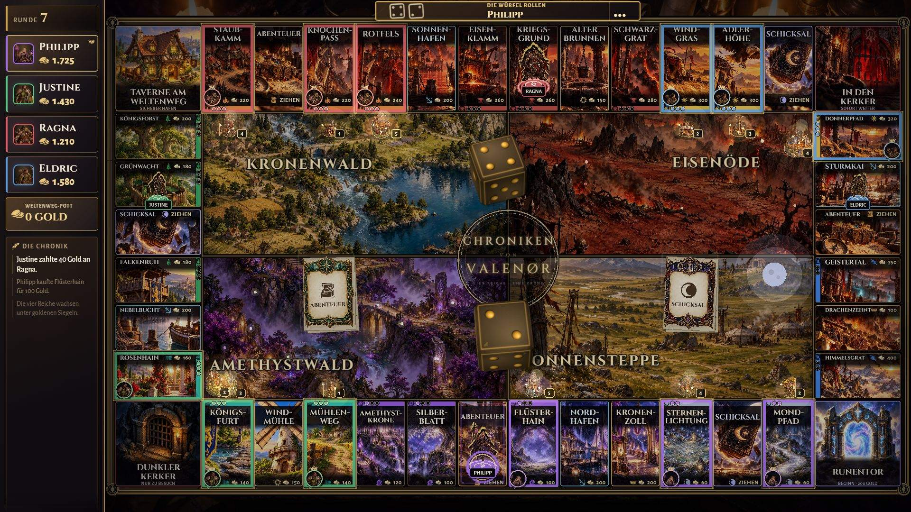 |
| Pasch 5 und 5 | 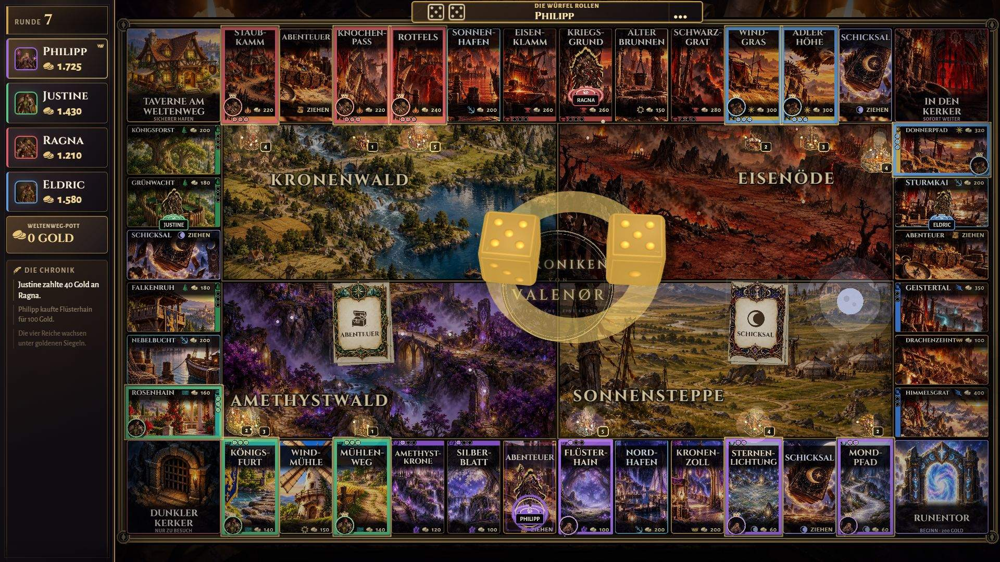 |

Bewegt: 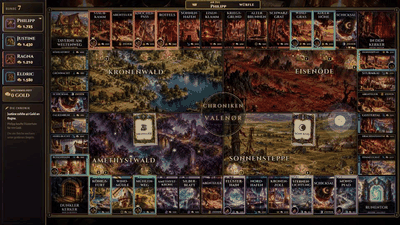

## Stimmungen und Tageszeiten

- Jedes der acht Chronik-Ereignisse hat eine eigene Stimmung, die weich überblendet (1,5 s; auf „low“ und bei reduzierter Bewegung 0,2 s):
  - **Blutmond:** rot mit rotem Mond.
  - **Frieden der vier Reiche:** warmes Gold.
  - **Fest der Händler:** Lichtfunken.
  - **Segen des Runentors:** blaues Licht.
  - **Segen der Baumeister:** glühende Gebäude.
  - **Rohstoffknappheit:** kühl und entsättigt.
  - **Erlass der Krone:** gedämpft.
  - **Goldene Baukonjunktur:** Gold, Funken und glühende Gebäude.
- **Tag und Nacht** wandern mit den Runden: je zwei Runden Morgen, Tag, Abend und Nacht. Abends glimmen die ersten Fenster. Nachts leuchten Fenster und Fackeln an allen Gebäuden, und ein blasser Mond steht über der Sonnensteppe.
- **Lesbarkeit:** Der Farbschleier deckt höchstens 18 % und liegt unter Besitz, Gebäuden und Figuren. Ein Test sichert das ab.
- **Effekte je Stufe:**
  - Auf „high“ und „medium“: Farbstimmung über Phaser postFX und eine Vignette.
  - Nur auf „high“: ein weiches Glühen an den Lichtquellen.
  - Auf „low“: nur der ruhige Schleier.

| Ansicht | Bild |
| --- | --- |
| Stimmungen 1–4 | 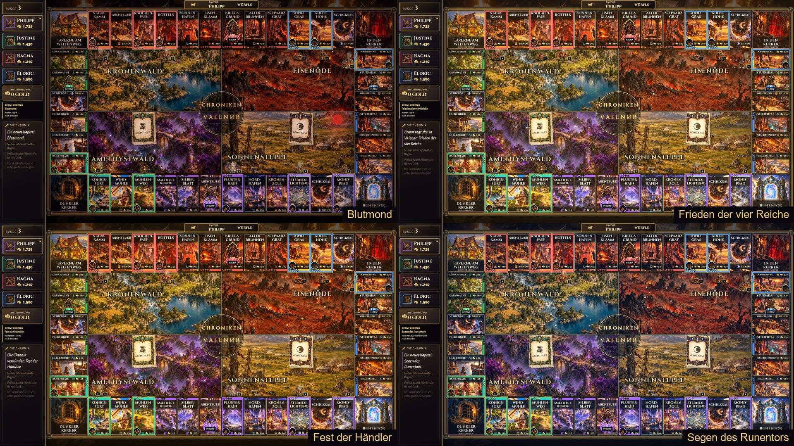 |
| Stimmungen 5–8 | 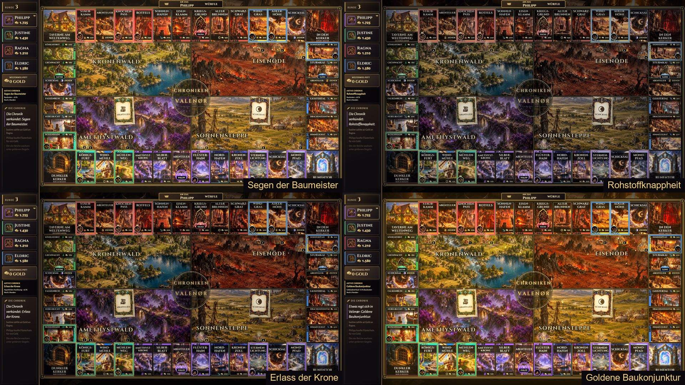 |
| Tageszeiten | 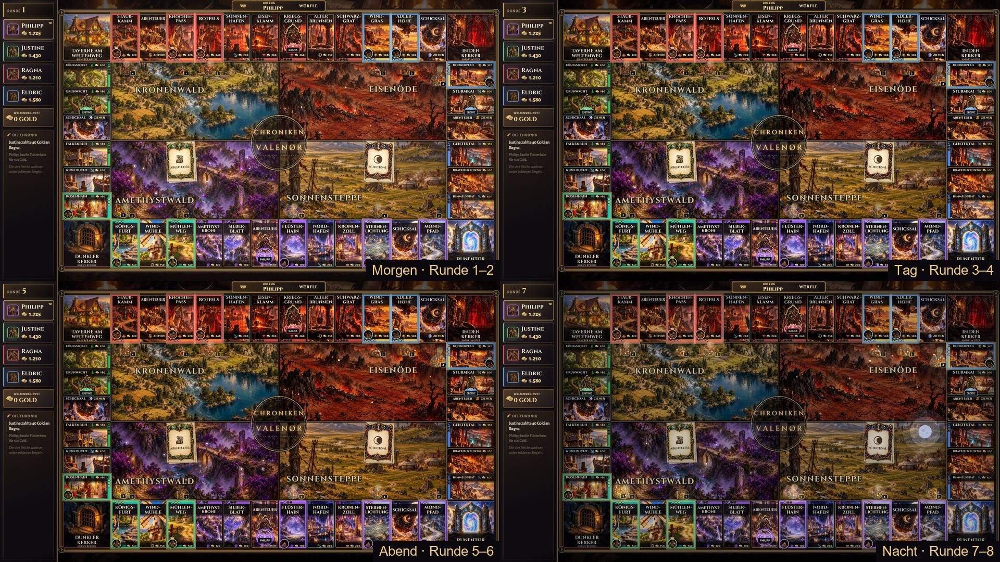 |
| Nacht: Mond, Fenster, Fackeln | 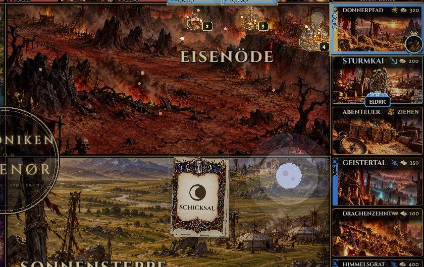 |
| Blutmond | 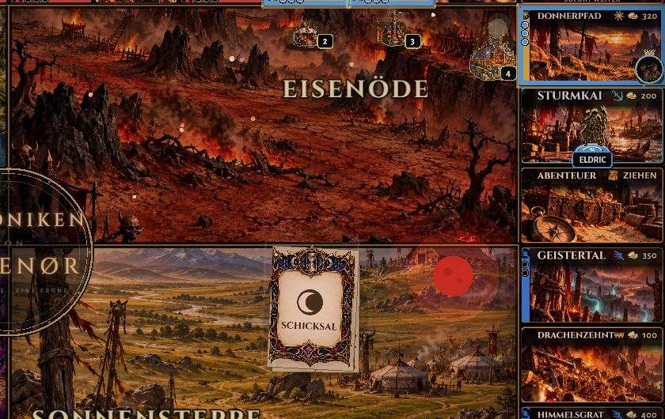 |

## Karte ziehen

Die Karte fliegt vom Stapel zur Mitte und wendet sich in 3D. Für künftige Kartenbilder gibt es einen Platz (`CARD_ART` in `asset-manifest.ts`), bis dahin zeigt er das Stapelsymbol. Bei reduzierter Bewegung und auf „low“ erscheint die Karte ohne Flug und Wendung.

| Ansicht | Bild |
| --- | --- |
| Gewendete Karte | 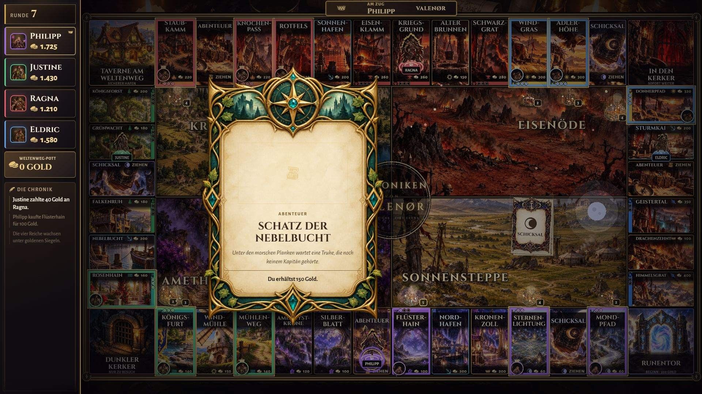 |

Bewegt: 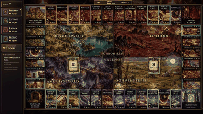

## Bildrate

Gemessen am 28.10.2026 auf diesem Laptop:

- **Hardware und Browser:** Intel Iris Xe, Chromium headless mit D3D11, 1920×1080.
- **Messung:** Takt von `requestAnimationFrame`, das ist die Spielschleife von Phaser.
- **Werte:** Bilder pro Sekunde, Spanne über mehrere Läufe.

| Szene | high | medium | low |
| --- | --- | --- | --- |
| Ruhendes Brett (Nacht, Glühen) | 52–59 | 54–60 | 59–60 |
| Kamerafahrt hohe Miete | 40–53, meist ~51 | 52–57 | 58 |
| Würfelwurf (3D, auf low klassisch) | 50–54 | 45–54 | 59–60 |
| Ziehen mit Mitgehen | 56–60 | 55–60 | 60 |
| Fest der Händler mit Funken | 55–59 | 53–60 | 60 |

- **Vor der Optimierung** halbierte ein bildschirmweiter Bloom auf „high“ die Bildrate auf 27–29 FPS. Er ist ersetzt durch:
  - Glühen nur an den Lichtquellen;
  - eine CSS-Vignette über der Leinwand (kostet keinen Durchgang in Phaser);
  - eine 3D-Würfel-Leinwand, die nur die Brettmitte abdeckt, ohne Wurf unsichtbar ist und ihre Shader vorab übersetzt.
- **Kamerafahrt:** Mit ausgeschalteten Kamerafahrten misst derselbe Moment ebenfalls 50–53 FPS. Die Fahrt selbst kostet also nichts Messbares; die Last kommt vom Mietmoment (Text, Effekte, Meldungen).
- **Grenze:** Glatte 60 FPS hält auf dieser Laptop-Grafik nur „low“. „high“ und „medium“ fallen in den belebtesten Momenten kurz auf etwa 45–53 FPS.

## Visual-QA-Szenen

Alle Szenen unter `/visual-qa?scene=…`. Der Moment startet 5,2 s nach dem Laden, damit das Brett schon steht.

- **Würfel:** `dice-roll`, `dice-double`
- **Spielstart:** `grand-start` sowie `controller-grand-start` (Handy)
- **Kamera:** `camera-dragon`, `camera-rent`, `camera-group`, `camera-build5`, `camera-bankrupt`, `camera-auction`, `camera-move`
- **Karte:** `card-flip`
- **Stimmungen:** `mood-<ereignis>` für alle acht Ereignisse, zum Beispiel `mood-blood-moon`
- **Tageszeiten:** `time-morning`, `time-day`, `time-evening`, `time-night`
- **Qualität:** Mit `&quality=low|medium|high` lässt sich jede Szene in einer anderen Stufe ansehen.

## Tests

- **Würfel:** 24 Drehungen des Würfels; jeder Wurf ist reproduzierbar, landet flach, liegt in der Arena und hat Aufpralle; alle 36 Ergebnisse über 25 Würfe; Pasch.
- **Kamera:**
  - Fahrten dauern höchstens 2 s und zoomen höchstens 1,35-fach.
  - Abklingzeit 30 s, Ausnahmen, Vorrang.
  - Mit dem Schalter aus gibt es keine Fahrten.
  - Keine Fahrt zeigt den Tisch neben dem Brett.
  - Mitgehen und Dauer des Spielstarts.
- **Stimmungen:** Acht verschiedene Stimmungen, Lesbarkeit, Tageszeiten nach Runde, Stufen high/medium/low und reduzierte Bewegung.
- **Server:** Spielstart überspringen nur durch den Startspieler, nur am Anfang und nur im Zeitfenster.
