# Lebendiges Brett

Chronist, Reaktionen vom Handy, Spannungsmomente, Lebenszeichen je Reich und die Siegerpose. Alles ist reine Darstellung: Kein Effekt verändert den Spielstand, und der Server wartet nie auf eine Animation. TV-Ansichten wurden in 1920 × 1080 aufgenommen und auf 960 px verkleinert, Handy-Ansichten in 390 px Breite.

| Ansicht | Bild |
| --- | --- |
| Brett vorher (main) | 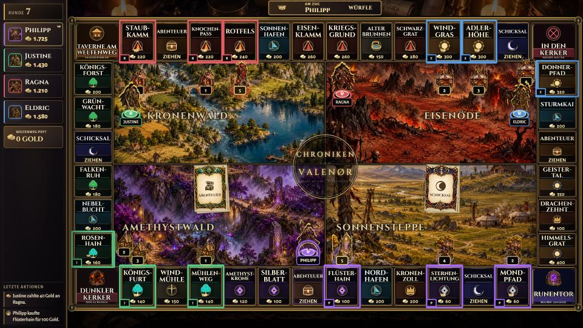 |
| Der Chronist in der Seitenleiste |  |
| Reaktionen am Porträt | 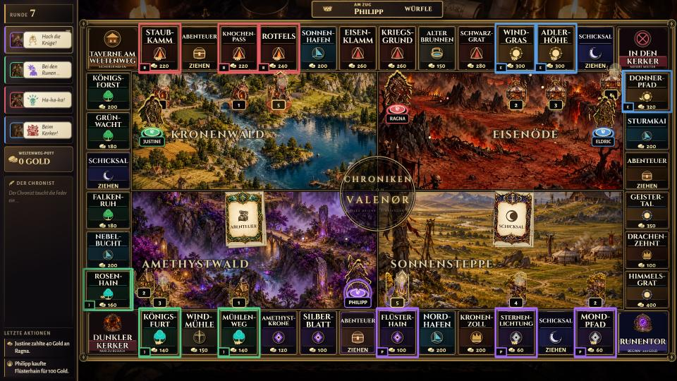 |
| Reaktionen auf dem Handy | 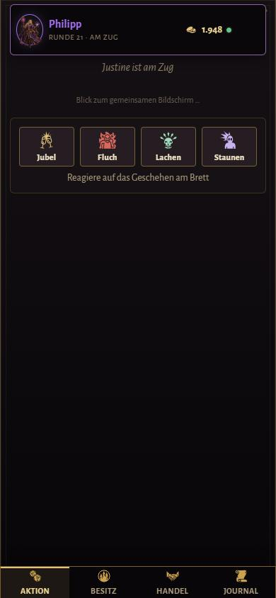 |
| Reaktionen während der Abklingzeit | 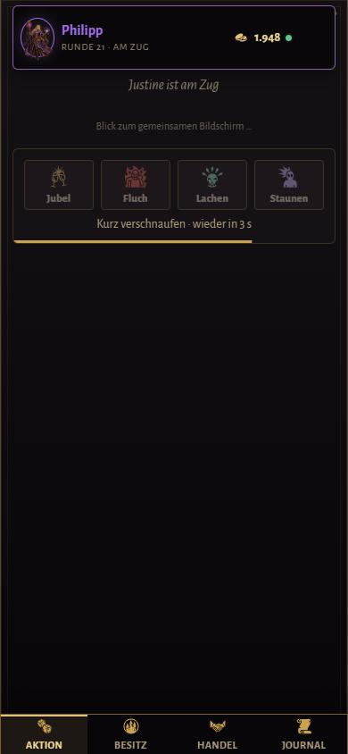 |
| Hohe Miete | 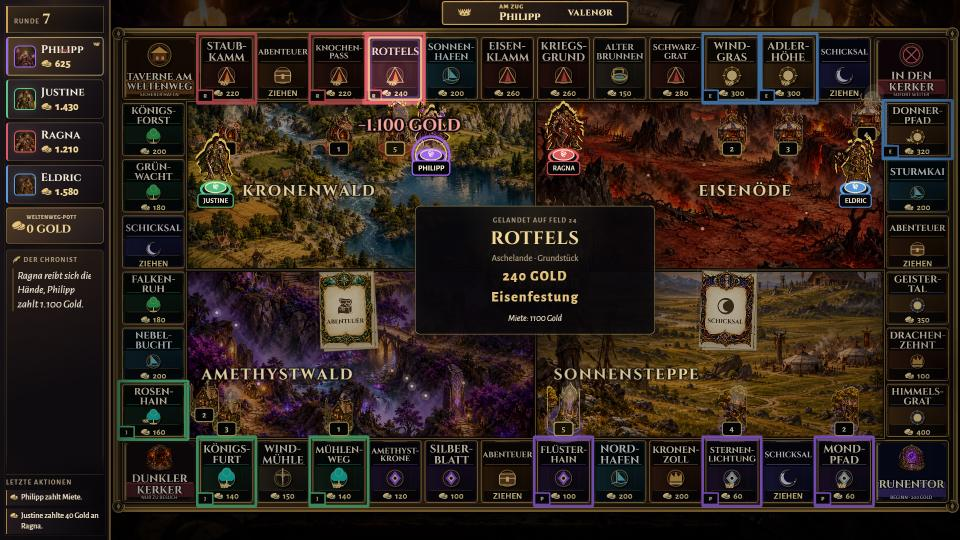 |
| Hohe Miete, ruhig (reduzierte Bewegung) | 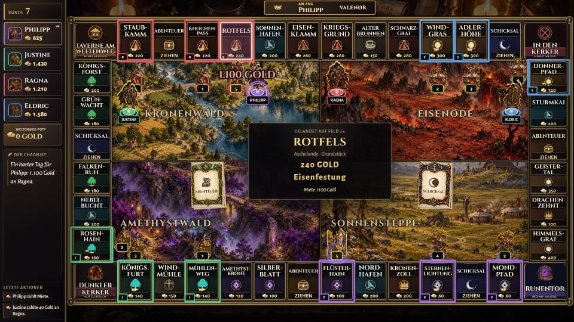 |
| Drachenbegegnung | 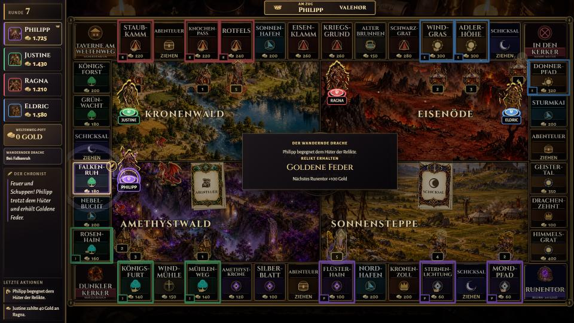 |
| Besiegelter Handel |  |
| Bankrott droht | 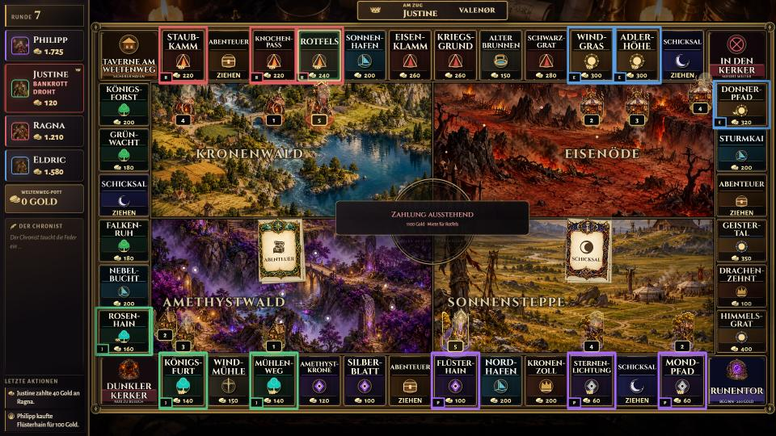 |
| Lebenszeichen: Rauch über Bauten, Glut in der Eisenöde | 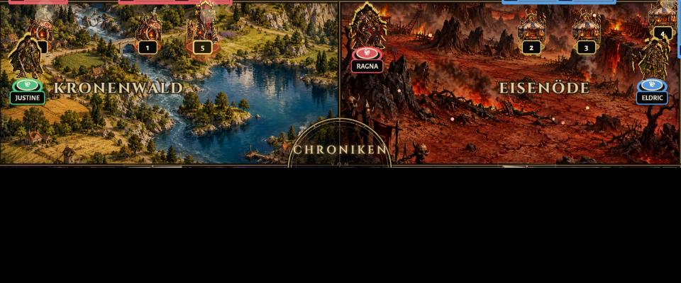 |
| Lebenszeichen: Glühwürmchen im Amethystwald | 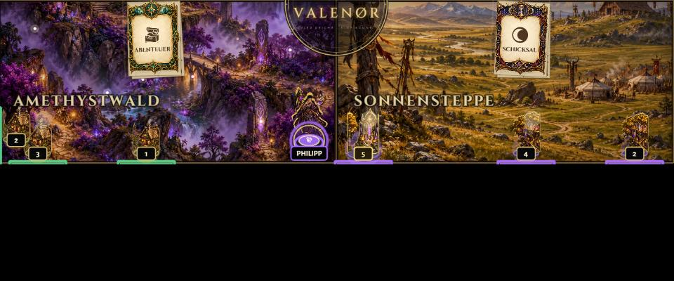 |
| Siegerpose bei geteiltem Sieg | 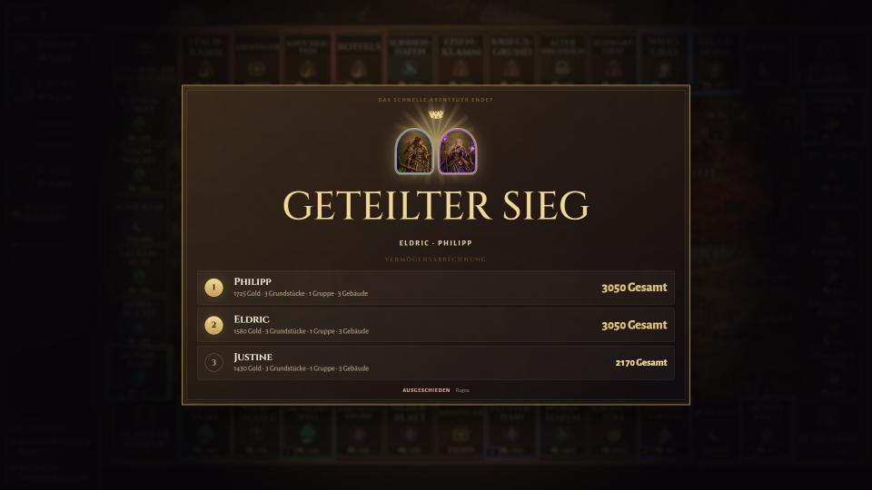 |

## Qualitätsstufen

Die Stufe lässt sich mit `?quality=low`, `?quality=medium` oder `?quality=high` in der Adresse wählen; der Bildschirm merkt sie sich. Ohne Angabe gilt `high`.

| | high | medium | low oder reduzierte Bewegung |
| --- | --- | --- | --- |
| Lebenszeichen | Rauch, Glut, Glühwürmchen, Wolken, Vögel | weniger, ohne Vögel | aus |
| Figuren hüpfen und jubeln | ja | ja | aus |
| Spannungsmomente | Licht, Abdunkeln, Bewegung | wie high | ruhiger Farbakzent ohne Bewegung |
| Chronist, Reaktionen, Bankrott-Warnung | mit Einblendung | mit Einblendung | sichtbar, ohne Animation |

## Neu erzeugen

Dev-Server starten (`npm run dev`) und die Szenen unter `http://localhost:5173/visual-qa?scene=<name>` aufnehmen: `chronist`, `emotes`, `controller-emotes`, `controller-emotes-cooldown`, `drama-rent`, `drama-bankrupt`, `drama-dragon`, `drama-trade`, `ambient`, `victory-pose`, `victory-pose-shared`. Die Effekt-Szenen spielen ihren Spielzug gut drei Sekunden nachdem das Brett bereit ist (`data-board-ready` am Canvas); `data-last-moments` zeigt, welcher Moment erkannt wurde.
