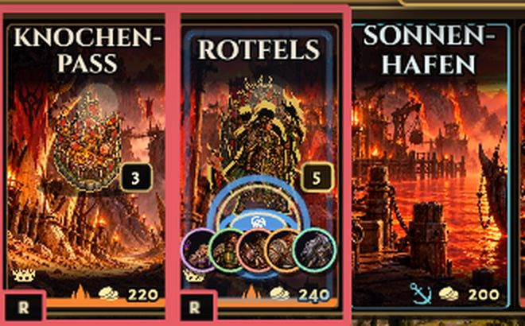
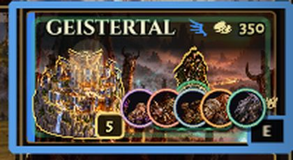
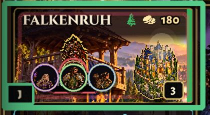
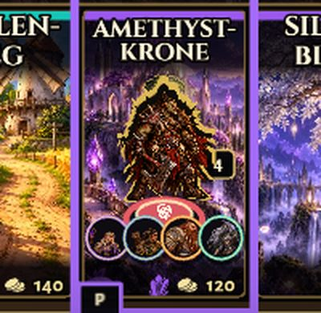
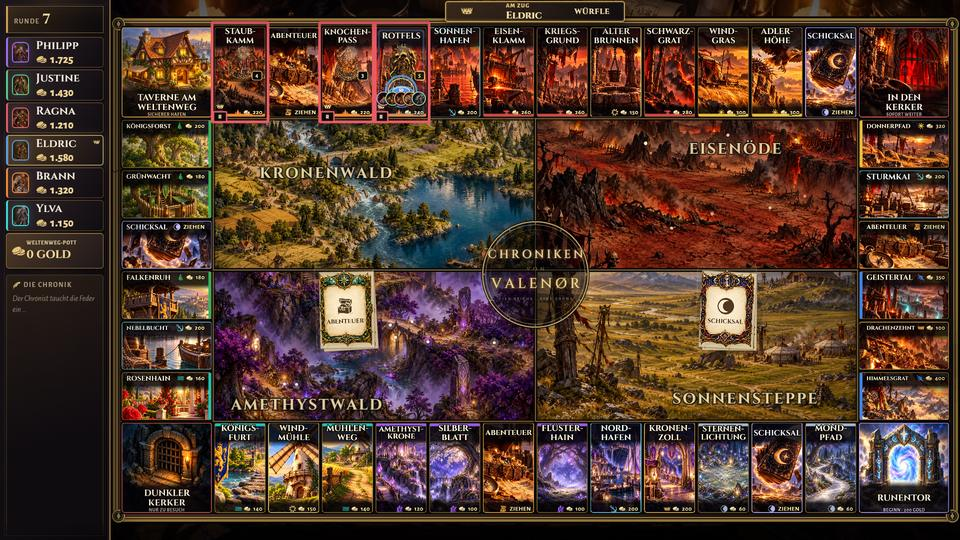
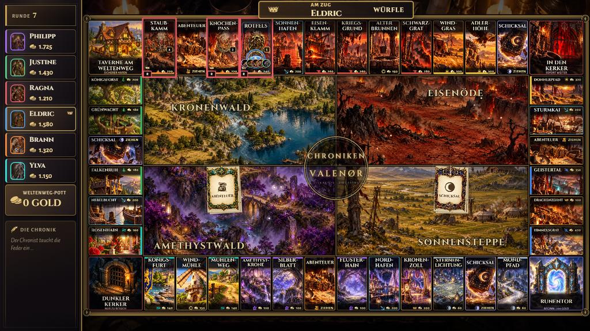
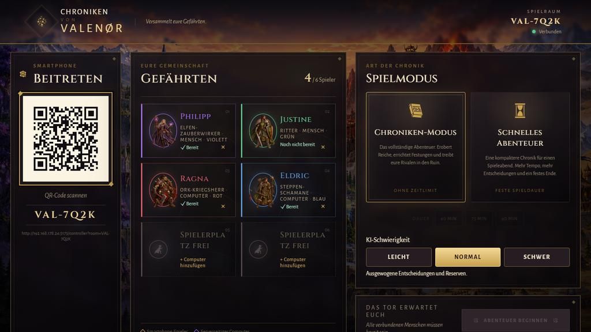
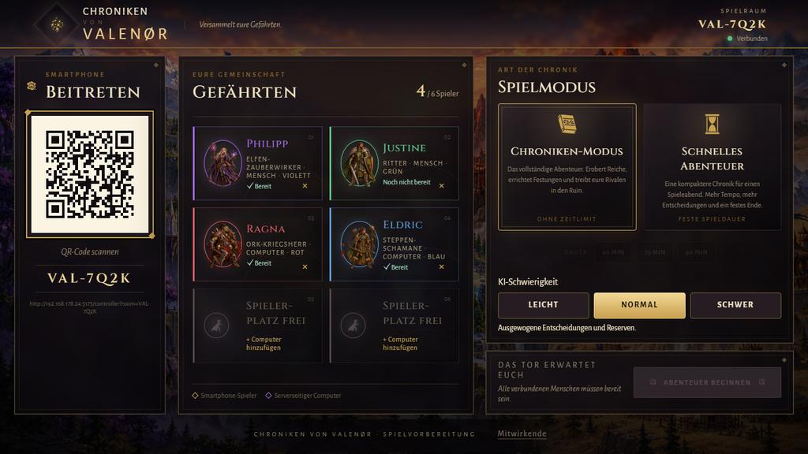
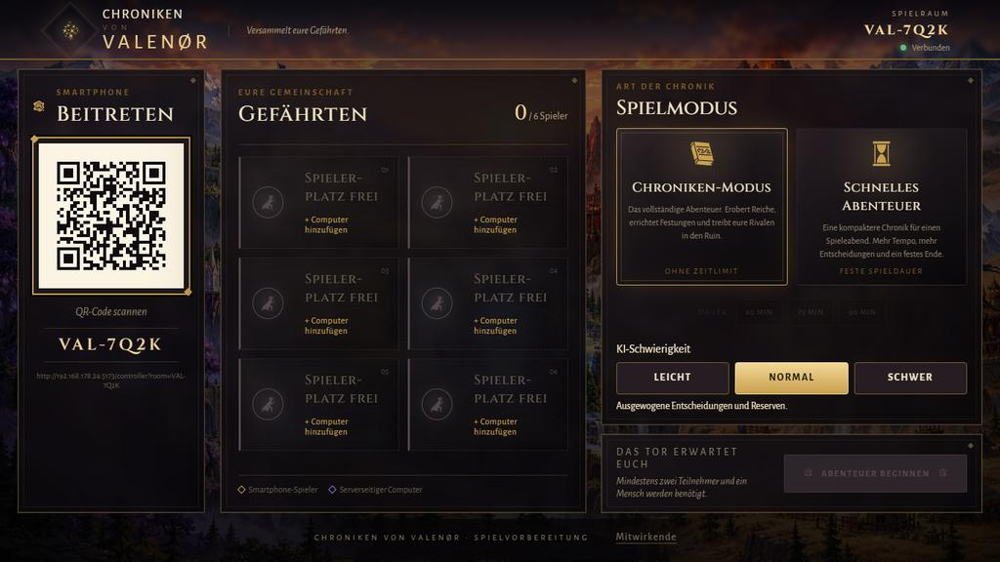
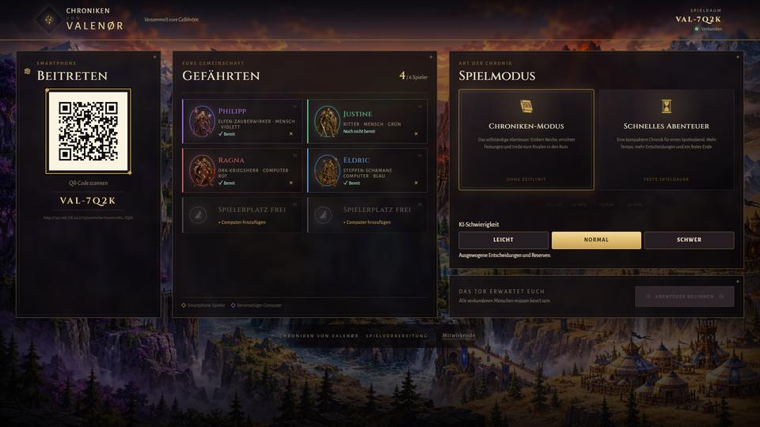

# Stimme und Feinschliff

Wappen auf vollen Feldern, die Lobby auf flachen Bildschirmen, die Stimme des Chronisten auf dem TV und ein Handy, das sich meldet, wenn man am Zug ist. Die Spielregeln sind unverändert.

## Wappen auf vollen Feldern

Ab vier Figuren auf einem Feld steht nur noch eine als Figur: die aktive, oder – wenn sie woanders steht – die, die als Nächste am Zug ist. Alle anderen zeigen ein kleines rundes Wappen mit Porträt im Ring ihrer Spielerfarbe, in Spielreihenfolge am Fuß des Feldes. Oben und unten darf die stehende Figur dafür vor das Gebäude treten. Zieht eine Figur weg, stehen die übrigen beim Landen sofort wieder als Figuren.

| Ansicht | Bild |
| --- | --- |
| Sechs Figuren, Baustufe 5 (oben) |  |
| Sechs Figuren, Baustufe 5 (Seitenfeld) |  |
| Vier Figuren, Seitenfeld mit Gebäude |  |
| Volles Feld, die aktive Figur steht woanders |  |
| Sechs Figuren in der Ecke |  |
| Ganzes Brett, 1920 und 1366 |   |

Vorher: [`../brett/detail-stufe5-6-figuren.jpg`](../brett/detail-stufe5-6-figuren.jpg), [`../brett/detail-seite-stufe5-6-figuren.jpg`](../brett/detail-seite-stufe5-6-figuren.jpg).

## Lobby bei 1366 × 768

„Spielerplatz frei“ trennt nur noch an der Silbe („Spieler-/platz“), und auf flachen Bildschirmen (bis 820 px Höhe) passt die ganze Lobby ohne Scrollen auf den Bildschirm: Kopfzeile, Abstände und Modus-Karten werden etwas kompakter.

| Ansicht | Bild |
| --- | --- |
| Vorher |  |
| Nachher, mit Gefährten |  |
| Nachher, leer |  |
| 1920 (unverändert) |  |

## Die Stimme des Chronisten

57 Sätze, vom Projektinhaber mit ElevenLabs gesprochen, liegen als MP3 (mono, 24 kHz, 48 kbit/s, zusammen 1,4 MB statt 4,5 MB) unter `apps/client/public/assets/audio/voice/` und stehen im Audio-Manifest (`VOICE_FILES` in `audio-config.ts`).

| Ereignis | Dateien | Wann |
| --- | --- | --- |
| Spielbeginn | `start-1/2` | einmal pro Partie, auch nach einem Neuladen des TVs nicht doppelt |
| Sieg | `sieg-<figur>` (8 Figuren), `sieg-gemeinsam` | Figur des Siegers; bei mehreren Siegern „gemeinsam“ |
| Bankrott | `bankrott-1/2/3` | Vorrang |
| Drache | `drache-1/2/3` | Vorrang |
| Gruppe vollständig | `gruppe-elfen/menschen/orks/steppe` | Reich der Gruppe |
| Bau | `bau-max-<reich>` | nur Baustufe 5 |
| Hohe Miete | `miete-hoch-1/2` | gleiche Schwelle wie der Spannungsmoment |
| Handel besiegelt | `handel-1/2` | |
| Auktion gewonnen | `auktion` | |
| Kerker | `kerker-rein-1/2`, `kerker-raus-1/2` | |
| Taverne | `taverne-gewinn-1/2`, `taverne-verlust` | |
| Pasch | `pasch` | |
| Letzte Runde | `letzte-runde` | |
| Chronik-Ereignis | `ereignis-…` (8) | je Ereignis |
| Weltimpuls | `impuls-…` (10) | je Impuls |
| Kauf, Abgabe, Runentor | – | still |

So spricht er:

- Nur auf dem TV, nie auf den Handys.
- Pro Spielstand höchstens ein Satz: zuerst Sieg, Bankrott oder Drache, sonst der wichtigste Moment.
- Nie zwei Sätze gleichzeitig. Neue Sätze warten in einer kurzen Schlange (höchstens drei); wichtige stehen vorn. Normale Sätze, die länger als 6 Sekunden warten, werden verworfen, wichtige nach 15 Sekunden.
- Bei mehreren Varianten zufällig, aber nie zweimal hintereinander dieselbe.
- Die Musik sinkt beim Sprechen auf 30 % und kommt danach sanft zurück.
- Eigener Regler „Stimme des Chronisten“ und Schalter „Stimme an/aus“ in den Audio-Einstellungen am TV, getrennt von Musik und Effekten.

## Das Handy meldet sich

- „Du bist am Zug“ brummt zweimal kurz (120 ms, Pause 80 ms, 120 ms) statt einmal 80 ms.
- Dazu ein kurzer, heller Zwei-Ton, im Browser erzeugt, damit er auch auf iPhones klingt, die aus dem Browser nicht vibrieren. Das Tippen auf „Valenør betreten“ schaltet den Ton frei; Schalter „Zug-Ton an/aus“ im Audio-Menü des Handys.
- Solange man im Spiel ist, hält das Handy den Bildschirm wach (Wake Lock API). Kommt man aus dem Hintergrund zurück, wird die Sperre erneuert; ohne API passiert nichts.

## Neu erzeugen

`/visual-qa?scene=<name>`: `board-tokens-4`, `board-tokens-6`, `board-tokens-6-side`, `board-tokens-5-waiting`, `board-corner-6`, `lobby`, `lobby-empty`. Die Sprachdateien wandelt ein kleines Skript aus `assets-neu/stimme/` um (Python mit `miniaudio` zum Lesen und `lameenc` zum Schreiben); Stille am Anfang und Ende wird dabei gekürzt.
