# Übersicht

Verbesserungen nach einer echten Partie: Gruppen und Besitz auf einen Blick, das Zielfeld auf dem Handy, die eigene Figur finden, eine sichtbare Auktion, unverzerrte Figuren und Gebäude am Rand statt auf dem Feld. Die Spielregeln sind unverändert.

## Gruppen und Besitz

- An der Innenkante jedes Grundstücks liegt eine kräftige Leiste in Gruppenfarbe (12 px) mit dem Gruppensymbol und einem Punkt je Feld der Gruppe. Gehört ein Feld jemandem, ist sein Punkt in dessen Spielerfarbe gefüllt, freie Felder bleiben leer. Ein dunkler Rand hält die Punkte auch auf ähnlich gefärbten Leisten sichtbar.
- Landet eine Figur auf einem Grundstück, leuchten alle Felder seiner Gruppe kurz auf (bei reduzierter Bewegung und „low“ ohne Pulsieren).
- Jedes Feld mit Besitzer trägt ein Wappen mit Porträt im Ring der Spielerfarbe samt kleinem Wimpel; der Rahmen in Spielerfarbe bleibt.
- Eine komplette Gruppe bekommt eine Krone auf dem Wappen und einen doppelten Rahmen in Gold und Besitzerfarbe, der ruhig schimmert.

| Ansicht | Bild |
| --- | --- |
| Komplette Gruppe (Eisenöde, Ragna) | 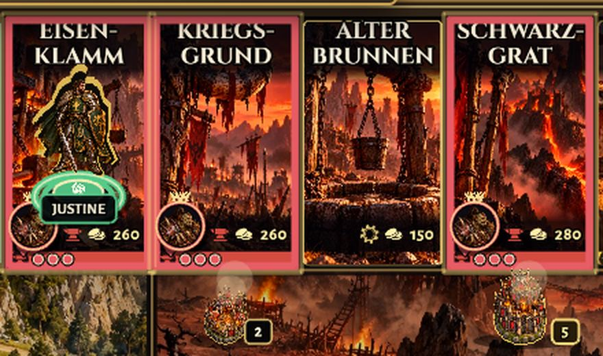 |
| Gruppenleiste unten mit Punkten | 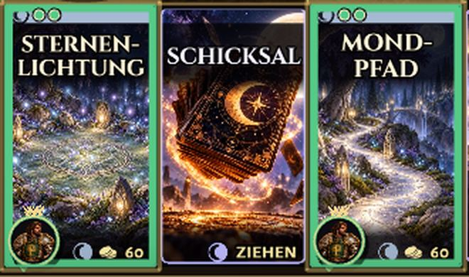 |
| Ganzes Brett, 1920 und 1366 | 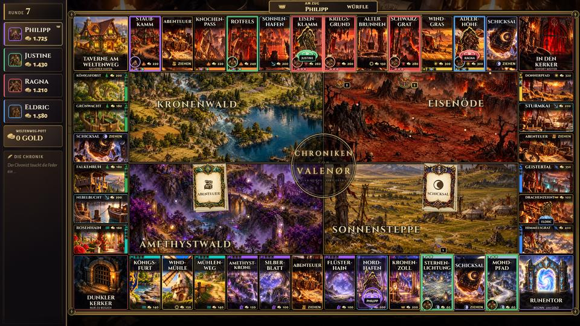 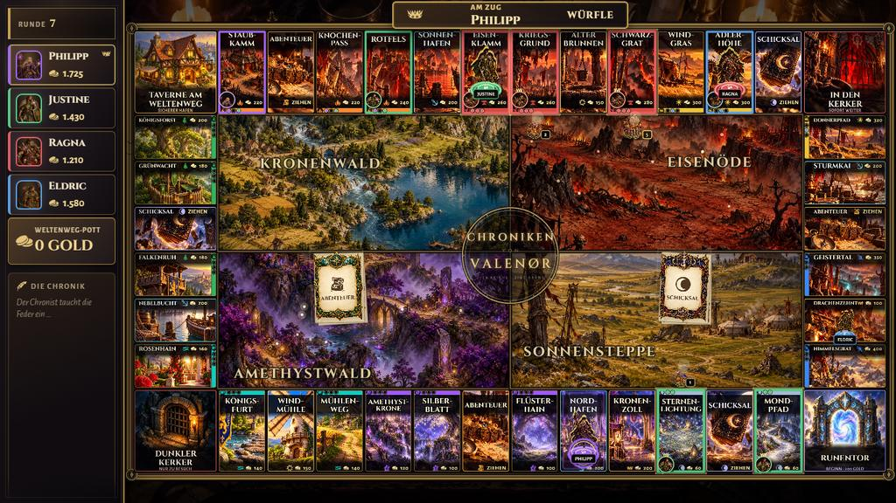 |

## Gebäude am Rand

Gebäude stehen außerhalb des Feldes an seiner Innenkante und ragen ins Mittelbild hinein (oben nach unten, unten nach oben, links nach rechts, rechts nach links). Feldbild, Name und Figuren bleiben frei. Meldungen beginnen erst unter dem Gebäudestreifen, und der Drache weicht weiter nach innen aus.

| Ansicht | Bild |
| --- | --- |
| Vorher |  |
| Nachher, 1920 | 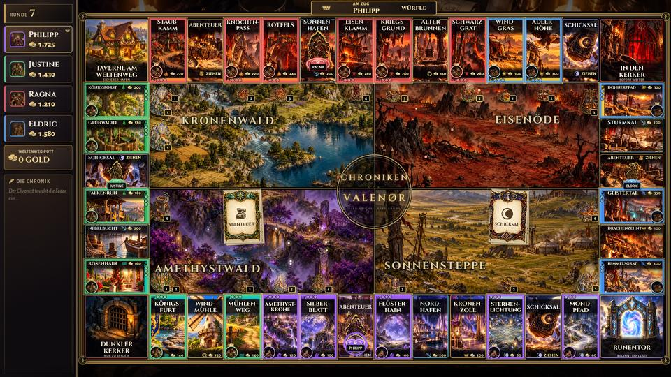 |
| Nachher, 1366 | 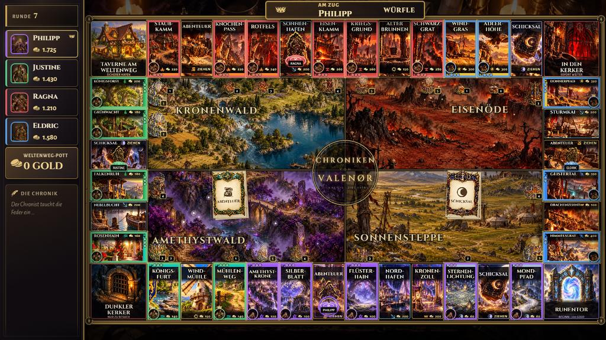 |

## Figuren

- Figuren werden nur noch gleichmäßig skaliert. Ursache der Verzerrung war der Hüpfer beim Ziehen, der Breite und Höhe getrennt stauchte; kam währenddessen ein neuer Spielstand, blieb die Figur gestaucht. Jede Aufstellung setzt die Figur jetzt wieder auf das richtige Seitenverhältnis.
- Auf den Seitenfeldern stehen die Figuren in einer Reihe, so groß wie es passt (etwa 60 % der Größe oben und unten). Bei vollen Feldern steht die Figur links, die Wappen rechts daneben.
- Jede Figur hat einen kräftigen Sockelring in ihrer Spielerfarbe, die Figur am Zug zusätzlich einen weichen Lichtkegel.
- „Wo bin ich?“ auf dem Handy lässt die eigene Figur bzw. das eigene Wappen drei Sekunden lang mit Ringen pulsieren (bei reduzierter Bewegung ein ruhiger Ring). Der Server prüft die Anfrage und erlaubt sie nur alle drei Sekunden.

| Ansicht | Bild |
| --- | --- |
| Seitenfeld, 1 Figur | 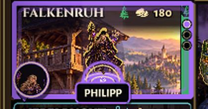 |
| Seitenfeld, 3 Figuren | 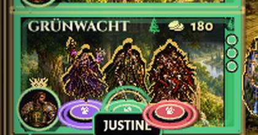 |
| Seitenfeld, 6 Figuren | 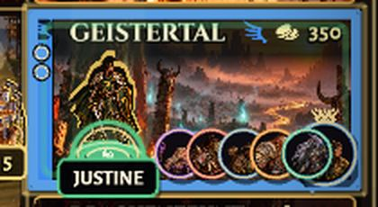 |
| „Wo bin ich?“ für ein Wappen | 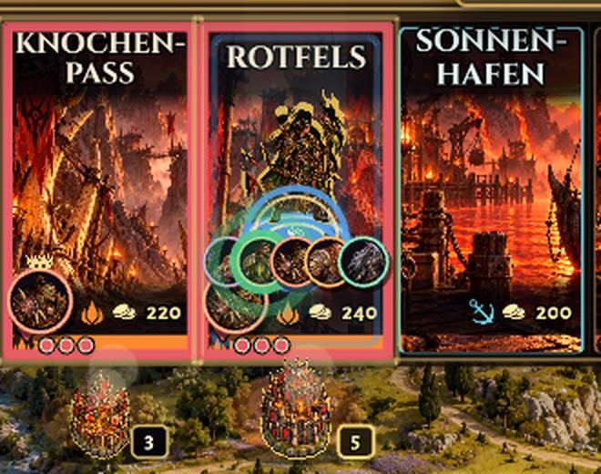 |

## Auktion

Solange eine Auktion läuft, trägt das versteigerte Feld einen goldenen Rahmen, Licht und einen Hammer und pulsiert leicht (ruhig bei reduzierter Bewegung und „low“). Die Auktionsanzeige zeigt das Feldbild groß.

| Ansicht | Bild |
| --- | --- |
| Das versteigerte Feld | 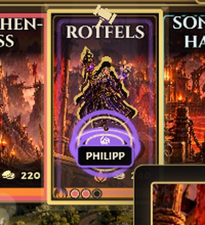 |
| 1920 und 1366 | 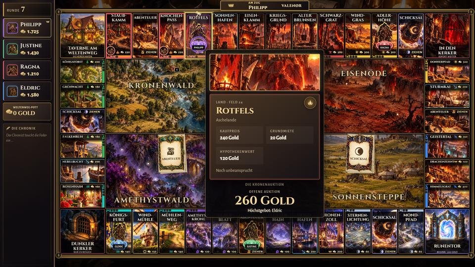 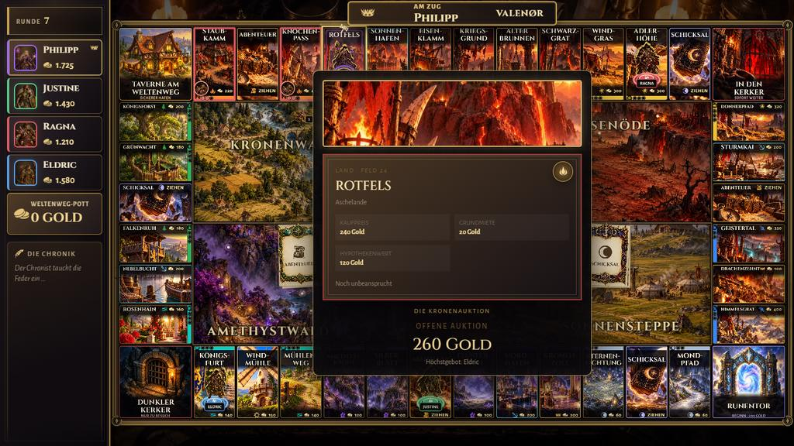 |

## Zielfeld auf dem Handy

Direkt nach dem eigenen Wurf zeigt das Handy das Zielfeld: Feldbild, Name, Gruppe, Besitzer und was dort passiert („Frei – kaufen für 260 Gold“, „Gehört Ragna – Miete 1.100 Gold“, „Dein Grundstück“, „Belehnt – keine Miete“, „Karte ziehen“, „Abgabe …“, „Ab in den Dunklen Kerker“). Sobald Kauf, Auktion oder Zahlung kommen, übernehmen deren Ansichten.

| Frei | Gehört jemandem |
| --- | --- |
| 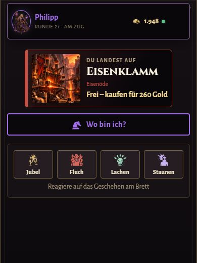 | 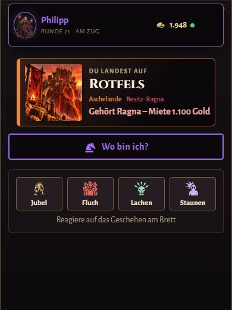 |

## Neu erzeugen

`/visual-qa?scene=<name>`: `board-side-1`, `board-side-3`, `board-tokens-6-side`, `board-buildings`, `board-auction`, `board-ownership`, `board-locate` (löst „Wo bin ich?“ nach sechs Sekunden aus), Handy in 390 px: `controller-target`, `controller-target-rent`.
